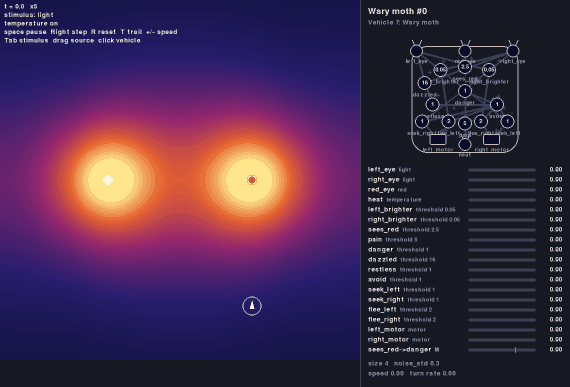

# Braitenberg-Vehicles
An implementation of the Vehicles described in the book [Vehicles](https://en.wikipedia.org/wiki/Braitenberg_vehicle) by Valentino Braitenberg, specially the most advanced ones

While there are many implementations of Braitenberg's Vehicles, almost all of them stop at Vehicle 4 (the simplest ones, which connect sensors directly to actuators). The goal of this repo is to implement Vehicles 5 and beyond, the ones that have a 'nervous system' between the sensors and the actuators.

## Examples

### Vehicle 5 — A moth that learns not to get burned


The moth is drawn to light and steers toward it. When it gets too close it gets burned: a *pain* unit fires and switches on a *burned* unit that feeds back into itself, so it stays on for good. From then on the same vehicle keeps its distance from every light. Its behavior depends on its history, which no vehicle without a nervous system can do. In the panel on the right you can watch `pain` and `burned` light up at the moment of the burn.

The whole brain is nine threshold units, described in [vehicles/vehicle5-moth.yaml](vehicles/vehicle5-moth.yaml):


```
python -m braitenberg scenarios/vehicle5-moth.yaml
```

See [specs/vehicle-05.md](specs/vehicle-05.md) for the design.

### Vehicle 7 — A moth that learns which lamp burns, and unlearns it



The wary moth has a connection that learns: a *Mnemotrix* wire from `sees_red` to `danger`. It starts too weak to carry a signal and grows stronger whenever the moth sees red while it is being burned. After a burn or two, seeing red alone means danger, and the moth turns away from the red lamp before it gets close, while it keeps visiting the white one. When the red lamp goes cold, seeing red without a burn weakens the wire again, and the moth goes back. In the panel, watch the bar `sees_red->danger` at the bottom cross the tick at 0.7.

```
python -m braitenberg scenarios/vehicle7-wary-moth.yaml
```

See [specs/vehicle-07.md](specs/vehicle-07.md) for the design.

## Running

### Setup

Requires Python 3.11 or later. From the repo folder:

```
python3 -m venv .venv
source .venv/bin/activate
pip install -e ".[dev,record]"
```

### Running the examples

Each example is a scenario in `scenarios/`. Run it with `python -m braitenberg` and the scenario file; a window opens with the arena on the left and a live diagram of the selected vehicle on the right.

| Example | What it shows | Command |
|---|---|---|
| Vehicle 1: Getting around | Speeds up where it is warm, lingers where it is cold | `python -m braitenberg scenarios/vehicle1-hot-spot.yaml` |
| Vehicle 2: Fear and aggression | 2a turns away from the light, 2b turns toward it and speeds into it | `python -m braitenberg scenarios/vehicle2-fear-and-aggression.yaml` |
| Vehicle 3: Love and explorer | 3a comes to rest facing the light, 3b slows down near it and wanders off | `python -m braitenberg scenarios/vehicle3-love-and-explorer.yaml` |
| Vehicle 4: Orbiter and decider | 4a circles the light, 4b turns away abruptly at a boundary | `python -m braitenberg scenarios/vehicle4-orbiter-and-decider.yaml` |
| Vehicle 5: Moth | Drawn to light until it gets burned once; then keeps its distance | `python -m braitenberg scenarios/vehicle5-moth.yaml` |
| Vehicle 5: Searcher | Zigzags until it sees a light, then goes straight to it | `python -m braitenberg scenarios/vehicle5-searcher.yaml` |
| Vehicle 5: Forager | Recharges at the light when hungry, zigzags away when full | `python -m braitenberg scenarios/vehicle5-forager.yaml` |
| Vehicle 5: Driver | Stops before a red traffic light, goes on green | `python -m braitenberg scenarios/vehicle5-driver.yaml` |
| Vehicle 6: Evolved forager | The hand-tuned forager next to one tuned by selection | `python -m braitenberg scenarios/vehicle6-forager.yaml` |
| Vehicle 7: Wary moth | Learns that the red lamp burns and keeps away from it; unlearns it when the lamp goes cold | `python -m braitenberg scenarios/vehicle7-wary-moth.yaml` |

In the window:

| Key or action | Does |
|---|---|
| Space | Pause or resume |
| Right arrow (while paused) | One step |
| R | Restart the scenario |
| T | Show or hide the trails |
| + / − | Faster or slower |
| Tab | Show the next stimulus in the heat map (e.g. `red` and `green`) |
| Drag a source | Move it; the vehicles react to the new field |
| Click a vehicle | Show its diagram in the panel |
| Esc | Quit |

### Other ways to run

```
python -m braitenberg scenarios/vehicle5-moth.yaml --seed 3                          # another random seed
python -m braitenberg scenarios/vehicle1-hot-spot.yaml --headless --steps 100000     # no window, as fast as possible
python -m braitenberg --world worlds/one-light.yaml --vehicle vehicles/vehicle2b-aggression.yaml   # any world and vehicle(s)
pytest                                                                               # run the tests
```

### Evolution (Vehicle 6)

```
pip install -e ".[analysis]"                                                         # matplotlib, for the plots
python -m braitenberg.evolve evolutions/forager.yaml                                 # tune the forager by selection
pytest -m slow                                                                       # the tests that take minutes
```

An evolution file (`evolutions/`) names a vehicle, a world and the numbers that may change. Each vehicle is tried alone and selection keeps the ones that last longest before running out of energy. The results (a log, the best vehicle as a definition file, and plots) go to `runs/`. See [specs/vehicle-06.md](specs/vehicle-06.md).

A simulation is built from three kinds of YAML files: worlds (`worlds/`), vehicle definitions (`vehicles/`) and scenarios that combine them (`scenarios/`). See [specs/scenarios.md](specs/scenarios.md).

## Images for the specs

```
python -m braitenberg.diagram vehicles/vehicle5-moth.yaml --out specs/images/vehicle5-moth.svg
python -m braitenberg.record scenarios/vehicle5-moth.yaml --seconds 40 --out specs/images/vehicle5-moth.gif
```

`diagram` draws a vehicle definition as an SVG. `record` plays a scenario without a window and saves it as a GIF (needs `pip install -e ".[record]"`).
