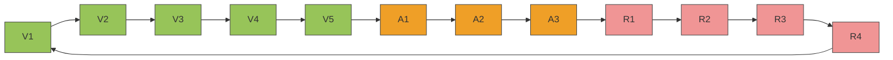
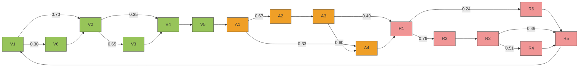
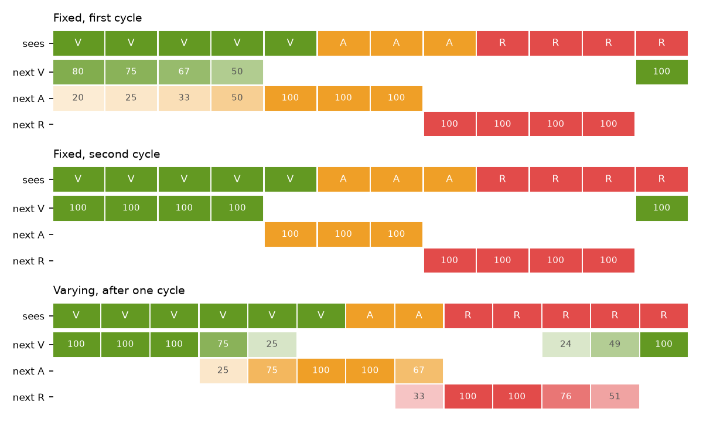

# A CSCG learns the traffic light

An experiment outside the simulator. It asks how a clone-structured cognitive graph (CSCG; George et al., *Clone-structured graph representations enable flexible learning and vicarious evaluation of cognitive maps*, Nature Communications 2021) would learn the sequence that the [Vehicle 11 cautious driver](../../specs/vehicle-11.md) learns with Ergotrix wires.

```
python experiments/cscg/cscg.py            # graphs and predictions as text
python experiments/cscg/cscg.py --plot     # also save predictions.png
```

## The setup

The input is the light seen one tick at a time: each color repeats for as long as it is on, as in `VVVVVAAARRRR` (V green, A yellow, R red). The world's light lasts 4.5 s per color, but here the durations differ, so that the graph has to learn each one.

A CSCG is a hidden Markov model in which each color has several hidden states, its *clones*, and a clone can only emit its own color. Here each color has 6 clones. Training learns only the transitions between clones: soft EM (Baum–Welch) and then Viterbi EM, which keeps the transitions sparse, as in the paper. 150 cycles are enough.

## What it learns

**Fixed durations** (`VVVVVAAARRRR` over and over). Of the 18 clones it uses exactly 12, in one ring, every transition with probability 1:



Each clone stands for a color *and a time within it*: V3 is "green, third tick". The graph learned to count without a clock.

**Varying durations** (each color lasts one tick more or less, at random: green 4–6, yellow 2–4, red 3–5). It is still a ring, but with skips and side paths, so that the paths through each color are as long as the durations it saw:



Clones are numbered in the order of the likeliest cycle; V6 and R6 are clones on a side path. Where along a color the skips fall is up to EM.

## What it predicts

Seeing the light tick by tick, the CSCG keeps a belief over its clones and from it the probability of each color on the next tick:



- **First cycle.** It does not know yet which green tick it is on: seeing the first V, any of the 5 green clones may be the last, so yellow is 20% likely. Each V without a change rules one out (25%, 33%, 50%, 100%). The first change of color tells it where it is in the ring. Starting to look halfway through the green is the same: it is unsure only until the first change.
- **From the second cycle on** it is certain. On V4 it says green; on V5, yellow with 100%.
- **Varying durations.** The first ticks of each color are certain; doubt appears only where the duration varies, and grows with time, like a hazard function: yellow 25% on the 4th green tick and 75% on the 5th; green 24% on the 3rd red tick and 49% on the 4th.

## Compared with the Ergotrix wires

| | Ergotrix (Vehicle 11) | CSCG |
|---|---|---|
| Where the sequence lives | Wires between colors (`sees_green → expects_yellow`) | Clones of each color, i.e. the context |
| When the next color comes | Not known: `expects_yellow` comes on as soon as green is seen; the driver needs `at_line` to decide when to stop | Known: P(yellow on the next tick) rises as the green goes on |
| Aliased sequences such as V→A→R→A→V | One wire `sees_yellow → expects_X` cannot tell what follows yellow | Two yellow clones, one for each context |
| State | Units on or off | A probability distribution over clones |

The last row is why this stays an experiment: putting a CSCG in a vehicle needs a new kind of unit with a probabilistic state, not just new wires. It is closer to HTM's temporal memory, and to Braitenberg's Vehicle 12, than to the Ergotrix wire.
