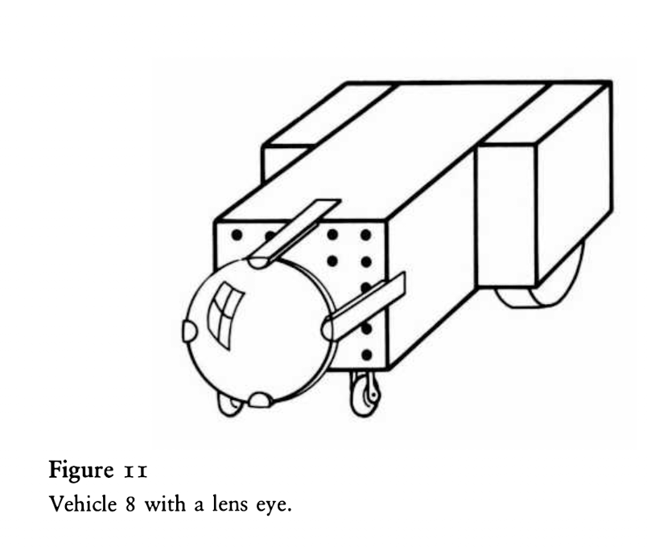

# Camera

## Summary

A **camera** is a sensor that sees an image instead of reading a field at one point. It looks out over a range of directions, left to right and up and down, and splits that view into a **matrix of pixels**. Each pixel reports how bright the things it sees are. Things have a size and a height, the nearest one hides those behind it, and a thing far away looks smaller, and closer to the horizon, than the same thing close by.

Braitenberg's Vehicle 8 ("Space, things and movements") needs this. Its eyes are arrays of sensors, each looking in its own direction, so the vehicle can tell **where** a thing is from **which** sensors see it, and that it **moves** from the order in which neighboring sensors light up. None of the sensors so far can do that: each reads the sum of every source's field at its position, and two lamps at the same distance look the same whatever direction they are in.



*Vehicle 8 with a lens eye (Braitenberg, Vehicles, Figure 11). The lens forms an image of the world on a grid of sensors behind it: the camera of this spec, with the grid as its matrix of pixels.*

The arena stays flat for movement: vehicles still drive on a plane. What this spec adds is height for **seeing**, so that an image has an up and a down. It adds three things:

- **Things in the world:** a stimulus source may have a `radius` and a `height`, which make it a visible upright cylinder. Vehicles are things too, boxes of their body's width, length and height, and may have an `appearance`.
- **Cameras:** a sensor with a `camera` section, whose output is a matrix of pixels, `rows` by `columns`.
- **Pixel inputs:** units and motors connect to one pixel or to a block of pixels, as in `from: retina[2, 3]` or `from: retina[:, 0:6]`.

It is a shared spec, like [sensors.md](sensors.md): it defines the sensor, and the Vehicle 8 spec will use it.

## Things

### Space

The arena is the ground, at elevation `z = 0`, with `x` and `y` as in [worlds.md](worlds.md). Elevations are in arena units, like distances. Nothing moves up or down: elevation only matters for what cameras see.

### Sources with a radius

A source may have a `radius` and a `height`, in arena units ([worlds.md](worlds.md), *Stimuli and sources*):

```yaml
stimuli:
  light:
    sources:
      - position: [30, 50]
        intensity: 10
        falloff: 15
        radius: 2          # a lamp 4 units across, visible to cameras
        height: 6          # and 6 units tall
```

A source with a `radius` is a **thing**: an upright cylinder standing on the ground, with that radius, centered on its position, from elevation 0 up to its `height`. `height` defaults to `2 * radius`, and is only allowed with a `radius`. A source without a radius is a point, and cameras do not see it; ordinary sensors read it as before. Radius and height change nothing about the field: it still follows `intensity / (1 + (distance / falloff)^2)` from the position.

A thing's **brightness** for a stimulus `S` is the `intensity` of its source when the source is a source of `S` and is on, and `0` otherwise. The whole surface of a thing has that brightness. A lamp switched off by its schedule is still there: it is a dark cylinder that hides what is behind it.

Sources of different stimuli with the same `position`, `radius` and `height` are **one thing**, lit in several stimuli. In `hot-lamp`, a red lamp with a radius, at the same place and with the same size as a white lamp, is one lamp that is bright for both `light` and `red`; its brightness for each stimulus is the sum of the intensities of its sources of that stimulus that are on. Sources at the same place with a different size are separate things.

Things are only seen. They do not block movement: a vehicle drives through a lamp as it does today.

### Vehicles as things

Every vehicle is a thing: a **box** standing on the ground, from elevation 0 up to the vehicle's `height`, whose footprint is the body's rectangle, `width` across and `length` from back to front, centered on the vehicle ([vehicle-definition.md](vehicle-definition.md), *1. General*). It moves and turns with the vehicle: its front always faces the heading. Its `height` is a new optional key of `general`, positive, default `size / 2`.

So the shape of a vehicle in an image depends on where it is seen from: a long, narrow vehicle seen from the side looks wide, and seen from the front or the back looks narrow. From a corner a camera sees two of its sides, and from above it sees its top.

#### Appearance: the color of each face

A box has five faces: `front` (the side facing the heading), `back`, `left`, `right` and `top`. Each face has a brightness for each stimulus, which is its color: a face bright for `red` and dark for `light` looks red to a red camera and black to a light camera. Each face is evenly lit, with no shading, so two faces of the same brightness side by side show no edge between them: a camera sees edges only where brightness changes.

By default every face is **gray**: brightness `5` for every stimulus, half the intensity of a typical lamp (`10`). A vehicle without an `appearance` is gray all over, seen against the dark ground and sky.

A definition may change the colors in a new top-level section, `appearance`. Each key is a stimulus, and its value is either a brightness for every face, or a mapping from faces to brightness, in which the faces not named stay gray:

```yaml
appearance:
  light:               # in light, a white front and a black back; left, right and top stay gray
    front: 10
    back: 0
  red: 8               # bright red on every face
```

Each key must be a stimulus of the world the vehicle runs in (a world may define a stimulus with an empty `sources` list just for this), and each face one of the five. Brightness is not negative. A vehicle that should look black in a stimulus says so with `0`; a black vehicle is not seen, but it hides what is behind it.

Faces make a vehicle's heading visible: a camera that sees a white front and a black back can tell whether a vehicle is coming or going, which an outline alone does not tell.

An appearance is only seen by cameras. It adds nothing to any field, so other vehicles' ordinary sensors do not sense it.

A camera never sees the vehicle it is mounted on.

Obstacles ([worlds.md](worlds.md), *Obstacles*) are seen the same way: boxes of their footprint and `height`, gray unless their `appearance` says otherwise. They do not move.

### Ground and sky

The ground and the sky are dark: a line of sight that reaches the ground, or goes up past everything, sees brightness `0`. The ground is opaque, so a camera looking down sees the ground and nothing below it.

## Cameras

### Declaring a camera

A camera is a world sensor with a `camera` section:

```yaml
- sensor:
    name: retina
    type: light            # the stimulus it sees
    position: [0, 0.9]
    field_of_view: 120     # required for a camera: the angle it spans from left to right
    camera:
      columns: 12          # 12 columns of 10 degrees each
      rows: 6              # 6 rows of 10 degrees each
      vertical_field_of_view: 60
      direction: 0         # where it looks, in degrees from the heading; + is to the left
      tilt: 0              # how far up it looks, in degrees; 0 is level, - is down
      height: 2            # elevation of the camera above the ground
      range: 60            # optional: farthest distance it sees
      samples: 3           # optional: 3 x 3 lines of sight per pixel
```

| Key | Required | Meaning |
|---|---|---|
| `field_of_view` | yes, for a camera | The horizontal angle the camera spans, in degrees, greater than 0 and at most 360. |
| `camera.columns` | yes | Number of columns, a positive integer. Each covers `field_of_view / columns` degrees from left to right. |
| `camera.rows` | yes | Number of rows, a positive integer. Each covers `vertical_field_of_view / rows` degrees from top to bottom. A camera with one row sees a strip. |
| `camera.vertical_field_of_view` | yes | The vertical angle the camera spans, in degrees, greater than 0 and at most 180. |
| `camera.direction` | no | The horizontal direction of the middle of its view, in degrees counterclockwise from the vehicle's heading (positive to the left, negative to the right), from -180 to 180. Default 0: straight ahead. Two cameras with `direction` 45 and -45 look to either side. |
| `camera.tilt` | no | The elevation angle of the middle of its view, in degrees: positive up, negative down. Default 0: level. Its view must stay within straight up and straight down: `abs(tilt) + vertical_field_of_view / 2 <= 90`. |
| `camera.height` | no | The camera's elevation above the ground. Positive. Default: the vehicle's `height`, on top of the body. |
| `camera.range` | no | Things whose nearest point is farther than this, measured along the ground, are not seen. Positive. Default: no limit. |
| `camera.samples` | no | The pixel is sampled by `samples × samples` lines of sight (see *What a pixel reads*). A positive integer. Default 3. |

`type` names the stimulus the camera sees, as for any world sensor: the scenario checks that it is a stimulus of the world. A camera's `response` ([vehicle-definition.md](vehicle-definition.md), *Responses*) applies to each pixel separately. An `energy` sensor cannot have a `camera` section.

### Pixels

Directions are measured from the camera: **azimuth** counterclockwise from the vehicle's heading, and **elevation** up from level. With `F = field_of_view`, `C = columns`, `D = direction`, `w = F / C`, and `V = vertical_field_of_view`, `R = rows`, `T = tilt`, `h = V / R`, pixel `[i, j]` (row `i` from `0` to `R - 1`, column `j` from `0` to `C - 1`) covers:

- the azimuths from `D + F/2 - j*w` down to `D + F/2 - (j+1)*w`, and
- the elevations from `T + V/2 - i*h` down to `T + V/2 - (i+1)*h`.

Row `0` is the **top** and column `0` the **leftmost**, as the vehicle sees them facing forward, like an image on a screen. The diagram shows them the same way.

### What a pixel reads

Each direction within the camera's view is a **line of sight**: a straight line from the camera at its `height` above its position on the body. It sees the first thing it meets, the ground, or the sky.

A pixel's **reading** is the average brightness of its lines of sight. The pixel's angular rectangle is divided into a `samples × samples` grid of equal cells, evenly in azimuth and in elevation, and one line of sight goes through the middle of each cell:

`reading = (sum over the pixel's lines of sight of the brightness they see) / samples^2`

A line of sight meets a thing where it enters it: through one of its sides, or, looking down from above it, through its top. A thing's **footprint** is the area it covers on the ground: a circle of its `radius` for a source, the body's rectangle for a vehicle. The first thing met is the one with the nearest entry point. Concretely, for a line of sight with azimuth `a` and elevation `e` from a camera at height `hc`:

1. Along the ground, it heads in direction `a`. It enters a thing's footprint at ground distance `s`; there it is at elevation `z = hc + s * tan(e)`. If `0 <= z <= ` the thing's height, it meets the side there.
2. Otherwise, if it is above the thing there and going down, it meets the top where `z` drops to the thing's height, if that happens over the footprint.
3. It meets the ground at ground distance `hc / tan(-e)` if `e < 0`.
4. It sees the nearest of these, or the sky.

So:

- A thing that fills a pixel reads its full brightness, **however far away it is**. Distance does not dim a thing, it makes it smaller: a lamp twice as far covers about half as many degrees in both directions, so it fills fewer pixels, or less of one.
- A thing standing on the ground appears with its base **closer to the horizon** the farther away it is. Together with its apparent size, this is what lets a vehicle judge distance by sight.
- A short thing in front of a tall one hides only the lower part of the tall one.
- A camera above a short thing, looking down, sees its top.
- A camera **inside** a thing (within its footprint and below its height) sees that thing in every direction, and nothing else. Inside a vehicle's box, it sees in each direction the face it would leave through.

With `edges: wrap`, each thing is seen once, where it is the shortest way around ([worlds.md](worlds.md)), as for distance. Things farther than `range` (ground distance to the nearest point of the footprint) are not seen and hide nothing; the ground beyond `range` is still seen, as dark.

**Why sampling.** For a disc in a flat world, how much of a pixel a thing covers has a closed form. With heights, lids and partial hiding it no longer does in general, and lines of sight handle every case the same way. With the default `samples` 3, a pixel's reading moves in steps of a ninth of a brightness as a thing slides across it; a larger `samples` makes it smoother and slower.

### Signal flow

The camera's pixels are read in step 1 of the signal flow ([vehicle-definition.md](vehicle-definition.md), *Signal flow*), with the other sensors, from the positions of all things at the start of the step: other vehicles are seen where they were before this step's moves, so the order of vehicles in a scenario does not matter.

## Pixel inputs

A camera's output is a matrix of `R × C` values, so an input names which pixels it takes, by row and column:

```yaml
inputs:
  - input:
      from: retina[2, 3]       # row 2, column 3 only
  - input:
      from: retina[:, 0:6]     # every row of columns 0 to 5: the left half, 36 inputs, all excitatory, strength 1
  - input:
      from: retina[3:6, :]
      type: inhibitory         # the bottom three rows, every column: 36 inhibitory inputs
```

- `name[r, c]` is the pixel in row `r`, column `c`. Each of `r` and `c` is an index `i`, a range `i:j` (from `i` to `j - 1`, as in Python, with `i < j`), or `:` for all of them. Indices go from `0` to `R - 1` for rows and `0` to `C - 1` for columns.
- An input with a range stands for one input per pixel in the block, each with the input's `type` and `strength`, as if they had been written out one by one.
- A camera must be named with a row and a column: `from: retina` or `from: retina[3]` is an error. A sensor that is not a camera, and units, cannot be indexed.
- Pixel inputs cannot have `learning`, like any input from a sensor ([vehicle-07.md](vehicle-07.md)).

A unit that sums `retina[:, 0:6]` sees the left half of the image; a threshold on it says "something bright on the left". Wiring a detector per pixel, such as Vehicle 8's movement detectors, uses arrays of units ([vehicle-08.md](vehicle-08.md)).

## Loading and validation

In addition to the cases in [worlds.md](worlds.md) and [vehicle-definition.md](vehicle-definition.md), loading fails, naming the file and the key, when:

- a source's `radius` or `height` is not a positive number, or it has a `height` without a `radius`;
- a vehicle's `general.height` is not a positive number;
- `appearance` is not a mapping; one of its values is neither a number nor a mapping of faces; names a face other than `front`, `back`, `left`, `right` and `top`; has a brightness that is negative or not a number; or (checked by the scenario) names a stimulus the world does not define;
- a `camera` section has an unknown key; is missing `columns`, `rows` or `vertical_field_of_view`; has `columns`, `rows` or `samples` that is not a positive integer; has `vertical_field_of_view` outside `(0, 180]`, `direction` outside `[-180, 180]`, or `abs(tilt) + vertical_field_of_view / 2` above 90; or has `height` or `range` not positive;
- a camera sensor has no `field_of_view`, or an `energy` sensor has a `camera` section;
- an input names a camera without a row and a column; indexes a sensor that is not a camera, or a unit; has an index or range outside the camera's rows or columns, or an empty range (`i >= j`); or is not of the form `name` or `name[r, c]`.

## In the arena and the diagram

[vehicle-diagram.md](vehicle-diagram.md) is updated to match:

- **Arena:** things are drawn to scale as seen from above: sources as discs of their radius (sources without a radius as now), and vehicles as rectangles of their footprint, turned with their heading, with a mark at the front. A vehicle is drawn gray, or, when its appearance gives a face a brightness above 0 for a stimulus named after a color, such as `red`, in that color. The `V` key shows or hides the selected vehicle's camera views: for each camera, the two edges of its horizontal field of view, out to its `range` or to the edge of the arena.
- **Diagram:** a camera is drawn at its position as a small grid of `R × C` cells, top row at the top and leftmost column on the left, each lit by its pixel's level. A wire from a pixel starts at that pixel's cell.
- **Readouts:** one block per camera, with its name and stimulus, and the image as a grid of `R × C` cells shaded by level, instead of one bar. The panel shrinks the cells to fit large cameras.
- **Levels:** each pixel's level is computed like a sensor's ([vehicle-diagram.md](vehicle-diagram.md), *Levels*), from that pixel's own targets.
- **Data model:** `diagram()` reports a camera as one part of kind `camera`, whose value and level are `R × C` matrices (lists of rows); a wire from a camera gives the row and column it comes from.
- **Static SVG:** a camera is drawn as the same grid of cells, labeled with its name and, below it, its stimulus, size and fields of view (e.g. `light, step at 3, 6×12 px, 120°×60°`). The wires from a camera to a part are one arrow, labeled with the inputs as written, such as `retina[:, 0:6]` (see [vehicle-08.md](vehicle-08.md), *In the diagram*). A vehicle with cameras or arrays of units is drawn at a larger scale, since it has many parts.

## Related specs

- [worlds.md](worlds.md): the optional `radius` and `height` of a source, and their validation.
- [vehicle-definition.md](vehicle-definition.md): the `camera` section of a sensor, the body's `length`, `width` and `height`, the `appearance` section, pixel inputs, and their validation.
- [sensors.md](sensors.md): cameras as a third kind of sensor, next to world and internal sensors.
- [scenarios.md](scenarios.md): a camera's `type` and an `appearance`'s keys are checked against the world.
- [vehicle-diagram.md](vehicle-diagram.md): things in the arena, camera views, and cameras in the diagram, readouts and SVG.

## Acceptance criteria

Unless stated otherwise the criteria use a camera at the body center with `field_of_view` 120 and 12 columns (10° each), `vertical_field_of_view` 60 and 6 rows (10° each), `direction` 0, `tilt` 0, `height` 1, `type: light`, a vehicle heading 90° (up), `edges: bounce`, and things placed in front of it. With `tilt` 0, rows 0 to 2 are above the horizon and rows 3 to 5 below it.

1. **Loading:** a world with a source `radius` and `height`, and a definition with a camera, `general.height`, an `appearance` and pixel inputs, load into objects that match the files. A source without `radius` loads as a point; a source with a `radius` and no `height` loads with `2 * radius`; a vehicle without `height` loads with `size / 2`; a camera without the optional keys loads with `direction` 0, `tilt` 0, the vehicle's height, no range and `samples` 3.
2. **Columns:** a thin thing straight ahead is seen only in columns 5 and 6; one 55° to the left only in column 0; one 55° to the right only in column 11; one behind the vehicle in none. With `direction` 90 a thing to the vehicle's left is seen in the middle columns.
3. **Rows:** a thing 2 units tall at ground distance 50 is seen only in rows 2 and 3, around the horizon. Moved to ground distance 4, its base appears lower: it reaches row 4. Raising its height to 30 at distance 10 makes it reach row 0. With `tilt` -25 the horizon is in row 0.
4. **Coverage:** a pixel whose whole angular rectangle is inside a thing reads its brightness; one with no line of sight on it reads 0; one partly covered reads its brightness times the fraction of its `samples^2` lines of sight that meet it. With `samples` 1, a pixel reads exactly what the line of sight through its middle sees.
5. **Size, not dimming:** a thing large enough to fill a whole pixel at ground distance 40 reads its full brightness in a pixel it fills, both at 40 and at 10, and covers fewer columns at 40 than at 10.
6. **Hiding:** a nearer thing hides a farther one in the directions they share, and the farther one is still seen where it sticks out: a short thing in front of a tall one hides the tall one's lower rows only. A camera with `height` 3 and `tilt` -45 above a thing 2 units tall sees its top. The ground hides nothing standing on it, and reads 0. A thing farther than `range` is not seen and hides nothing. A camera inside a thing reads that thing's brightness in every pixel.
7. **Brightness:** a camera sees only its own stimulus: a `light` camera reads 0 for a `red` lamp, which still hides a white lamp behind it. Coincident `light` and `red` sources of the same size are one thing, bright for both. A lamp switched off by its schedule reads 0 and still hides what is behind it.
8. **Vehicles:** a camera sees another vehicle as a box of its `width`, `length` and `height`, and a vehicle without `appearance` as gray, brightness 5. A vehicle with `appearance` `light: 0` is not seen and hides what is behind it. With `light: {front: 10, back: 2}`, a light camera reads 10 from a vehicle coming toward it, 2 from one going away, and 5 from its sides and, looking down from above, its top; a `red` camera reads 5 from every face. A vehicle with `width` 2 and `length` 8 at ground distance 20 covers a wider part of the image seen from the side than turned 45°, and turned 45° than seen from the front. A line of sight that passes a corner of a vehicle's footprint meets it, though it would miss a cylinder of radius `size / 2`, and the same line misses the vehicle turned 45° away from that corner. It never sees its own vehicle. An ordinary sensor's reading does not change when a vehicle with an `appearance` comes close. Two vehicles that see each other read the same values whichever comes first in the scenario.
9. **Wrap:** with `edges: wrap`, a thing just past the left edge is seen by a camera near the right edge looking left, at the shortest distance.
10. **Response:** a camera with a `step` response outputs `height` exactly in the pixels whose reading reaches `at`.
11. **Pixel inputs:** `retina[2, 3]` connects that pixel only; `retina[:, 0:6]` is the same as the 36 inputs `retina[0, 0]` to `retina[5, 5]` with its type and strength; a unit summing `retina[:, 0:6]` with a threshold fires for a thing on the left and not for one on the right.
12. **Validation:** each failure case under *Loading and validation* raises an error naming the file and the key.
13. **Nothing else changes:** fields with a `radius` and `height` are identical to those without, worlds and definitions without things or cameras load and behave as before, and every existing test passes unchanged.
14. **Diagram:** the diagram reports a camera as one part whose value and level are `R × C` matrices, every level in [0, 1], and each pixel wire with its row and column. The SVG draws the camera's grid, one cell per pixel, and one arrow per part its pixels feed, labeled with the inputs as written. The renderer draws a frame with things, a camera and camera views without errors, using SDL's dummy video driver.
15. **Headless and fast:** loading and running a vehicle with a camera never imports pygame. A scenario with 4 vehicles, each with an 8 × 16 camera and the default `samples`, in a world with 10 things, runs 60 simulated seconds at `dt` 0.05 headless in under 5 seconds.

## Out of scope

- **Movement in three dimensions:** vehicles stay on the ground, and things stand on it. Things that hang or fly, slopes and hills.
- **Several stimuli in one camera.** A camera sees one stimulus; a vehicle that sees `light` and `red` has one camera for each, which may share a position.
- **Shapes other than upright cylinders and boxes:** sources seen as boxes, vehicles made of several boxes, walls, spheres, shading, faces with patterns on them, and a ground or sky with brightness. Braitenberg's Vehicle 9 ("Shapes") may need more.
- **Things that block movement**, and collisions between vehicles.
- **Optics:** perspective projection onto a flat image plane (pixels are equal angles, not equal widths on a screen), blur, dimming with distance, glare, shading, noise in the pixels, and pixels that overlap.
- **Arrays of units:** writing one detector per pixel in a single item, such as "a movement detector between every two neighboring pixels". [vehicle-08.md](vehicle-08.md) adds them.
- Camera settings as Vehicle 6 gene targets, and an `appearance` that changes while the vehicle runs.
