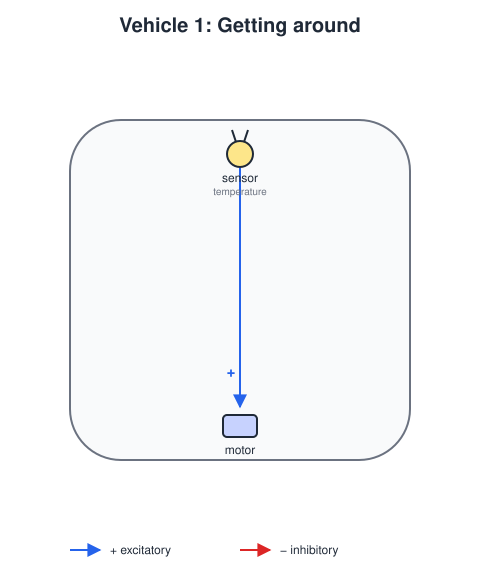

# Vehicle 1 — Getting Around

## Summary

The simplest vehicle: one sensor wired directly to one motor. The more of a stimulus the sensor detects, the faster the motor turns. With no steering of its own, the vehicle moves along a straight line, but small random perturbations (friction, an uneven surface) slowly deflect its heading. The result looks restless in warm areas, where it speeds up, and lingers in cold areas, where it slows down.

This vehicle sets up the shared building blocks every later vehicle reuses: world, stimulus field, sensor, motor, simulation loop and renderer.

## Definition

Vehicle 1 is defined in `vehicles/vehicle1.yaml` ([vehicle-definition.md](vehicle-definition.md)):

- **Body:** `size` 4, drawn as a small oriented shape so the direction is visible.
- **Sensor:** one, at the front of the body (`[0, 0.8]`), reading `temperature`.
- **Motor:** one, at the rear on the center line (`[0, -0.8]`), pushing the vehicle forward along its heading.
- **Connection:** direct and excitatory: `speed = base_speed + gain * sensor_value`, capped at `max_speed`.

| Value | Where in the file | Meaning | Default |
|---|---|---|---|
| `gain` | motor | sensor-to-motor multiplier | 1.0 |
| `base_speed` | motor | speed added regardless of stimulus | 0.0 |
| `max_speed` | motor | speed cap | 5.0 |
| `noise_std` | `general` | heading perturbation strength | 0.3 |

Default scenario: `scenarios/vehicle1-hot-spot.yaml` ([scenarios.md](scenarios.md)) places the vehicle at `[20, 20]`, heading 0, in `worlds/hot-spot.yaml` (a 100×100 wrapping arena with one heat source in the center), with `dt` 0.05 and seed 0.

## Dynamics

Each time step `dt`:

1. Read the sensor.
2. Compute the speed from the connection above.
3. Perturb the heading: `θ += noise_std * sqrt(dt) * N(0, 1)`. Without noise the vehicle would move in a straight line forever. With its one motor on the center line, Vehicle 1 never steers by itself.
4. Move: `x += speed * cos(θ) * dt`, `y += speed * sin(θ) * dt`.
5. Apply the edge rule.

All randomness comes from a seeded random generator, so runs are reproducible.

## Visualization

- Draw the stimulus field as a background heat map.
- Draw sources, the vehicle and an optional fading trail of its recent path.
- Interaction: drag sources with the mouse, pause/resume, step one frame, reset, toggle trail.
- A side panel shows a live diagram of the vehicle, as described in [vehicle-diagram.md](vehicle-diagram.md).

## Acceptance criteria

1. **Speed follows stimulus:** a vehicle placed near a source moves faster than one placed far from it.
2. **No stimulus, no motion:** with no sources and `base_speed = 0`, the vehicle does not move.
3. **Straight line without noise:** with `noise_std = 0`, the heading never changes.
4. **Lingers where it is cold:** in the default scenario, run headless for 100,000 steps. The time-averaged stimulus at the vehicle's sensor must be lower than the field's average over the whole arena (computed on a grid of at least 100×100 points). Check this for seeds 0 to 4; it must hold for each one.
5. **Reproducible:** two headless runs with the same seed and configuration produce identical trajectories.
6. **Headless:** the simulation runs without pygame being imported, as required by the architecture rule in [AGENTS.md](../AGENTS.md).

## Out of scope

- Multiple sensors or motors and steering (Vehicle 2 onward).
- Inhibitory connections (Vehicle 3).
- Collisions between vehicles.
