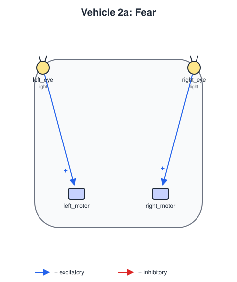
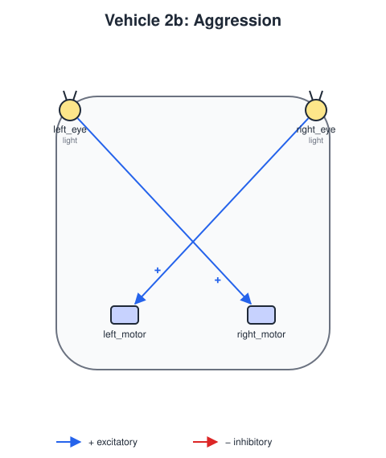

# Vehicle 2 — Fear and Aggression

## Summary

Vehicle 2 has two sensors at the front and two motors at the back, one on each side. Each sensor excites a motor: the more it senses, the faster that motor turns. Because the two sensors read different values when a source is to one side, the motors run at different speeds and the vehicle **steers**, which Vehicle 1 cannot do.

| Variant | Wiring | Behavior | Name in the book |
|---|---|---|---|
| **2a** | Straight: each sensor to the motor on its own side | The motor nearer the source runs faster, so the vehicle turns *away* from it | *Fear* (a coward) |
| **2b** | Crossed: each sensor to the motor on the opposite side | The motor farther from the source runs faster, so the vehicle turns *toward* it and speeds into it | *Aggression* |

## Definitions

 

`vehicles/vehicle2a-fear.yaml` and `vehicles/vehicle2b-aggression.yaml` ([vehicle-definition.md](vehicle-definition.md)):

- **Body:** `size` 4, `noise_std` 0.1.
- **Sensors:** `left_eye` at `[-0.9, 0.9]` and `right_eye` at `[0.9, 0.9]`, both reading `light`.
- **Motors:** `left_motor` at `[-0.5, -0.6]` and `right_motor` at `[0.5, -0.6]`, with `gain` 1, `base_speed` 0 and `max_speed` 10. The wide `max_speed` keeps the motors from saturating near the source, where both would run at the same speed and the vehicle would stop steering.
- **Connections:** one excitatory input per motor: straight in 2a, crossed in 2b.

## Scenario

`scenarios/vehicle2-fear-and-aggression.yaml` uses `worlds/one-light.yaml`, a light at `[60, 50]`. It places 2a at `[35, 44]` and 2b at `[35, 56]`, both with heading 0, so the light is ahead and slightly to one side of each.

## Acceptance criteria

1. **Steering:** in the default scenario, within 600 steps and for each of seeds 0 to 4, Vehicle 2a ends farther from the light than it started, and Vehicle 2b comes closer to it than half its body size.
