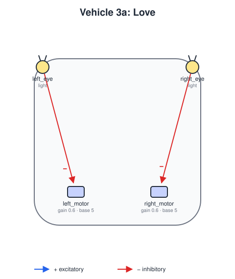
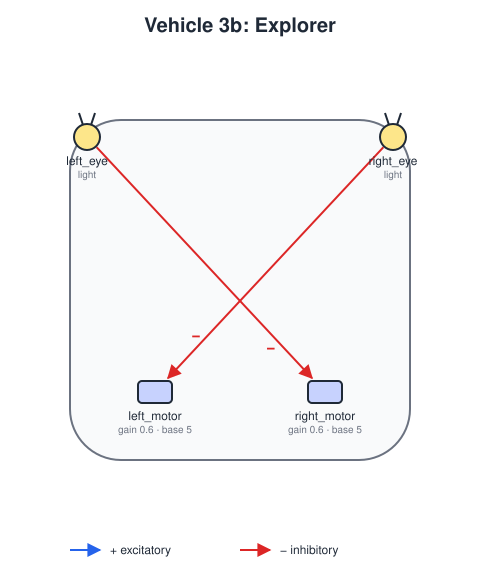

# Vehicle 3 — Love and Explorer

## Summary

Vehicle 3 has the body of Vehicle 2, with two sensors at the front and two motors at the back, but its connections are **inhibitory**: the more a sensor senses, the slower its motor turns. Its motors run at full speed when there is nothing to sense, and slow down near a source.

| Variant | Wiring | Behavior | Name in the book |
|---|---|---|---|
| **3a** | Straight: each sensor to the motor on its own side | Turns *toward* the source, slows down as it gets close and comes to rest facing it | *Love* |
| **3b** | Crossed: each sensor to the motor on the opposite side | Slows down near the source but turns *away* from it, and wanders off to look for another | *Explorer* |

Why 3a turns toward the source: with the source on its left, the left sensor reads more and slows the left motor more, so the right wheel is faster and the vehicle turns left, toward the source. Close to it both sensors read a lot, both motors slow to a stop, and the vehicle rests facing it. In 3b the crossed wiring slows the right motor instead, so the vehicle turns away.

## Definitions

 

`vehicles/vehicle3a-love.yaml` and `vehicles/vehicle3b-explorer.yaml` ([vehicle-definition.md](vehicle-definition.md)):

- **Body:** `size` 4, `noise_std` 0.1.
- **Sensors:** `left_eye` at `[-0.9, 0.9]` and `right_eye` at `[0.9, 0.9]`, both reading `light`.
- **Motors:** `left_motor` at `[-0.5, -0.6]` and `right_motor` at `[0.5, -0.6]`, each with `gain` 0.6, `base_speed` 5 and `max_speed` 5.
- **Connections:** one inhibitory input per motor: from the sensor on the same side in 3a, from the opposite side in 3b.

With these values a motor stops when its sensor reads `5 / 0.6 ≈ 8.3`, which in the default scenario is about 7 units from the light.

## Scenario

`scenarios/vehicle3-love-and-explorer.yaml` ([scenarios.md](scenarios.md)) uses `worlds/one-light.yaml`, a light at `[60, 50]`. It places 3a at `[35, 44]` and 3b at `[35, 56]`, both with heading 0, so the light is ahead and slightly to one side of each.

## Acceptance criteria

All criteria use the default scenario, run headless for 2000 steps, and must hold for each of seeds 0 to 4.

1. **Love comes to rest near the source:** at the end, 3a is closer to the light than half its starting distance, its speed is below 10% of `base_speed`, and it faces the light within 60°.
2. **Explorer turns away:** within the first 600 steps 3b comes closer to the light than it started. Within 600 steps of that closest approach, it gets at least 20 units farther from the light than it was at the closest point.
3. **Explorer never stops:** 3b's speed never falls below 20% of `base_speed`.
4. **Inhibition:** with both sensors reading the same value, each motor's speed is `base_speed - gain * reading`, clipped at 0.

## Out of scope

- Vehicle 3c, with several pairs of sensors for different stimuli, each pair wired differently.
