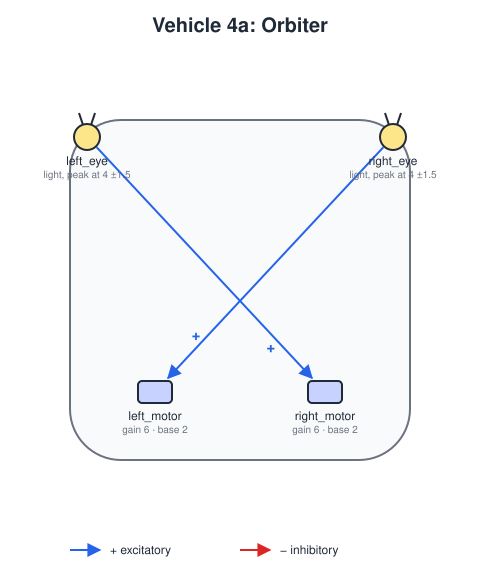
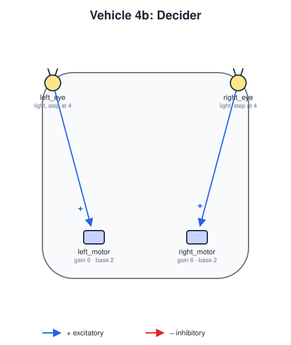

# Vehicle 4 — Values and Decisions

## Summary

Up to Vehicle 3, more stimulus always means more speed, or always less. Vehicle 4 makes that relationship a **curve**, through the sensors' response ([vehicle-definition.md](vehicle-definition.md), *Responses*). Its body is that of Vehicles 2 and 3: two sensors at the front and two motors at the back.

| Variant | Response | Wiring | Behavior |
|---|---|---|---|
| **4a** *Orbiter* | `peak`: strongest output at a middle reading | Crossed, excitatory | Far from the source it turns toward it, like Vehicle 2b; too close, it turns away. It settles into **circling the source** at its preferred distance. Braitenberg sees in this the beginning of *values* or *instincts*. |
| **4b** *Decider* | `step`: nothing below a threshold, then a jump | Straight, excitatory | It wanders, ignoring the source, until a sensor crosses the threshold; then that side's motor jumps to full speed and the vehicle **turns away abruptly**. It never enters a circle around the source, and looks as if it *decides* not to. |

Why 4a circles: with the source on its left, beyond the preferred distance the left eye's reading is closer to the peak, so its output is higher. Through the crossed wire it speeds up the right motor, and the vehicle turns left, toward the source. Inside the preferred distance the left eye's reading is past the peak, so its output is lower, and the vehicle turns away. The two balance at the preferred distance.

## Definitions

 

`vehicles/vehicle4a-orbiter.yaml` and `vehicles/vehicle4b-decider.yaml`:

- **Body:** `size` 4, `noise_std` 0.1.
- **Sensors:** `left_eye` at `[-0.9, 0.9]` and `right_eye` at `[0.9, 0.9]`, both reading `light`.
  - 4a: `peak` response with `at` 4 and `width` 1.5.
  - 4b: `step` response with `at` 4.
- **Motors:** `left_motor` at `[-0.5, -0.6]` and `right_motor` at `[0.5, -0.6]`, with `gain` 6 and `base_speed` 2, and `max_speed` 12 (4a) or 8 (4b).
- **Connections:** one excitatory input per motor: crossed in 4a, straight in 4b.

In `worlds/one-light.yaml` (intensity 10, falloff 15) a reading of 4 is about 18.4 units from the light. That is 4a's preferred distance and 4b's boundary.

## Scenario

`scenarios/vehicle4-orbiter-and-decider.yaml` uses `worlds/one-light.yaml`, a light at `[60, 50]`. It places 4a at `[35, 44]` and 4b at `[35, 56]`, both with heading 0.

## Acceptance criteria

All criteria use the default scenario, run headless for 3000 steps, and must hold for each of seeds 0 to 4.

1. **Orbiter circles the source:** over the second half of the run, 4a stays between 15 and 25 units from the light, and goes around it at least twice (its angle around the light changes by at least 720° in total, in either direction).
2. **Decider keeps out:** 4b never comes closer than 18 units to the light, but does come within 22 units at least once: it reaches the boundary and turns away, rather than never getting near.
3. **Decisions are abrupt:** 4b's motor speeds only ever take two values, `base_speed` and `base_speed + gain`.

## Out of scope

- Other response curves, and combinations with inhibitory wiring (both possible with the current format, but not part of this spec).
