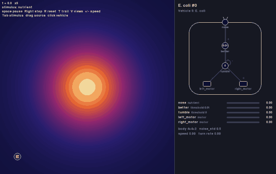
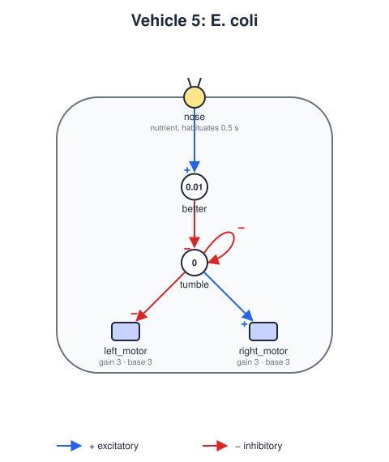

# Vehicle 5 — E. coli (run and tumble)

## Summary

The sixth example of Vehicle 5, summarized in [vehicle-05.md](vehicle-05.md) next to the others. The E. coli finds food with a single sensor, the way the bacterium does.

*Escherichia coli* is too small to tell its front from its back: across its body the food in the water hardly changes, so it cannot steer by comparing two sides, as Vehicles 2 to 4 do. Instead it compares over time. It swims straight for about a second (a **run**), then tumbles in place and sets off in a new direction (a **tumble**). While the food it senses keeps growing, it holds off tumbling, so runs that go up the gradient last longer and the others are cut short. None of its runs aims at the food, yet together they take it there: a random walk with a bias.

The vehicle does the same with one habituated sensor, the `nose`, which tells whether the food has grown in the last half second ([vehicle-definition.md](vehicle-definition.md), *Habituation*), and two threshold units. `better` fires while the food is growing. `tumble` fires when `better` is off, and silences itself, so that while things do not get better the vehicle tumbles every 1.5 s, and while they do it does not tumble at all. Where its runs end up comes from the noise of its body: in the bacterium, the jostling of the water molecules.

It combines two ideas: a memory of the immediate past, held in the sensor, and a rhythm of units, as in the searcher ([vehicle-05-searcher.md](vehicle-05-searcher.md)).



*The default scenario, first 120 seconds (seed 0, played at four times the speed). The heat map is the nutrient. Watch `better` and `tumble` in the panel: up the gradient `better` stays on and the runs are long; at the food, where the field is flat, nothing gets better and the E. coli tumbles every 1.5 s, which keeps it there.*

## Design



### Parts

- **Body:** `size` 4, `noise_std` 0.5. Over a second, the noise turns the heading by about 30° either way, as water turns the bacterium off course while it swims.
- **Sensor:** `nose` at `[0, 1]`, on the center line at the front, reading `nutrient` with a `linear` response and `habituation` with `tau` 0.5. Its output is about `0.5 * speed * slope`, where `slope` is how fast the nutrient grows along the vehicle's way: with the speed of 3, `1.5 * slope`.
- **Motors:** `left_motor` at `[-0.5, -0.7]` and `right_motor` at `[0.5, -0.7]`, `base_speed` 3, `gain` 3, `max_speed` 6. Both run at 3 on a run, so the E. coli swims straight.

### Units

| Unit | Inputs | Threshold | Delay | Fires when | Role |
|---|---|---|---|---|---|
| `better` | `nose` | 0.01 | 0.05 | the nose reads at least 0.01: the nutrient has grown in the last half second | Getting better |
| `tumble` | inhibitory `better` and itself | 0 | 0.5 | `better` is off and `tumble` has not just fired | Tumble |

### Running and tumbling

`tumble` fires on its own unless something stops it, and it stops itself: once on, its own output silences it. So while `better` is off it is on for its delay, 0.5 s, and off for twice that, about 1 s, over and over ([modules.md](modules.md), *The wander module*, *Clocks*): a tumble, then a run of at least 1 s, then the next tumble if things are still not better. While `better` is on, `tumble` cannot fire, and the E. coli runs for as long as the food grows. A tumble already under way finishes.

`better` decides what counts as better. 100 units from the food the slope is about 0.024, so the nose reads about 0.036 heading straight to it, and `better` fires while the E. coli heads within about 75° of the food; nearer the food the slope is steeper, and the angle is wider. At the food itself the field is flat, nothing gets better whichever way it heads, and it tumbles every 1.5 s, which keeps it near.

A tumble stops the left motor and speeds up the right one:

| Motor | Excitatory | Inhibitory |
|---|---|---|
| `left_motor` | | `tumble` |
| `right_motor` | `tumble` | |

So it turns about its left wheel at 3 radians per second: 1.5 radians, about 86°, to the left in a tumble of 0.5 s, plus the noise. The bacterium tumbles to any side; the vehicle always to the left, and the noise of its body, during the tumble and the run that follows, makes each new direction different.

### Without habituation

With `habituation` taken out, the nose reads the nutrient itself, which is above 0.01 everywhere in the dish. `better` is then always on and the vehicle never tumbles after the start: it runs straight, wanders with the noise of its body and bounces off the walls, as likely away from the food as toward it. It is the memory in the sensor that lets one sensor climb a gradient.

## World, definition and scenario

- `worlds/nutrient-gradient.yaml`: a 200 × 200 dish (`edges: bounce`) with one stimulus, `nutrient`, and one source in the middle, at `[100, 100]`, with `intensity` 10 and `falloff` 40: the nutrient reads 10 at the source, 5 at 40 units and about 1.4 at 100, so the gradient reaches every corner.
- `vehicles/vehicle5-ecoli.yaml`: the definition above.
- `scenarios/vehicle5-ecoli.yaml`: one E. coli at `[20, 20]`, heading 0, about 113 units from the food; `dt` 0.01.
- `specs/images/vehicle5-ecoli.svg` and `specs/images/vehicle5-ecoli.gif`: the diagram and the recording above.

```
python -m braitenberg scenarios/vehicle5-ecoli.yaml
python -m braitenberg.diagram vehicles/vehicle5-ecoli.yaml --out specs/images/vehicle5-ecoli.svg
python -m braitenberg.record scenarios/vehicle5-ecoli.yaml --seconds 120 --every 0.2 --speed 4 --scale 0.5 --out specs/images/vehicle5-ecoli.gif
```

## Acceptance criteria

Distances are from the body's center to the source.

1. **Finds the food:** in the default scenario, for each of seeds 0 to 4, the E. coli comes within 20 units of the source within 120 s. (Seeds 0 to 9 take 46 to 80 s; a straight run would take about 31 s.)
2. **Stays there:** in the default scenario, for each of seeds 0 to 4, once the E. coli has come within 20 units of the source it never gets farther than 30 from it, until 300 s. (Seeds 0 to 9 stay within 24.)
3. **Needs habituation:** with the same definition without `habituation`, for each of seeds 0 to 4, in 300 s, the vehicle spends less than 10% of the time within 20 units of the source, and `tumble` comes on at most once. (Seeds 0 to 9 spend at most 7%.)
4. **Running and tumbling:** with chosen readings and `noise_std` 0, once the delays have passed: while the nose outputs 0.01 or more, `better` is on and `tumble` never comes on; while it outputs less, `tumble` is on for 0.5 s and off for about 1 s, again and again, first coming on 0.5 s after `better` goes off. Each tumble turns the heading 1.5 radians to the left, and between tumbles the heading does not change.
5. **Without noise:** with `noise_std` 0, the E. coli still comes within 20 units of the source within 120 s, and the same way for every seed.

## Out of scope

- Tumbling to a random side, or for a random time: the noise of the body is the vehicle's only chance.
- Tumbling now and then even while things get better, as the bacterium does, and sensing relative rather than absolute changes in the food, which lets the bacterium climb gradients over a wide range of concentrations.
- Many bacteria, and food that they eat up.
