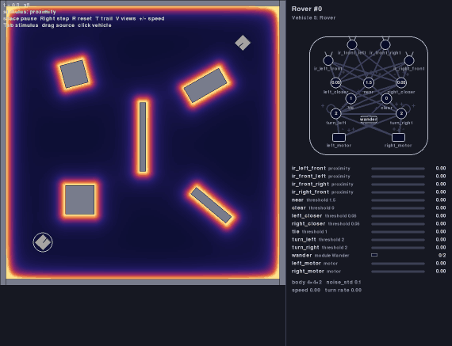
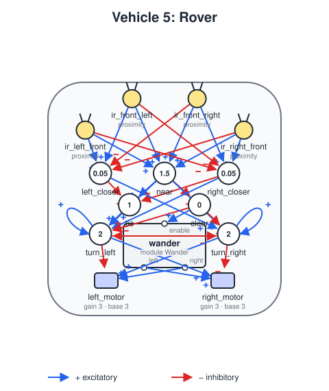

# Vehicle 5 — Rover (infrared)

## Summary

The fifth example of Vehicle 5, summarized in [vehicle-05.md](vehicle-05.md) next to the others. The rover explores a room full of walls and blocks, and other rovers, without bumping into anything. It senses them with four infrared sensors that look ahead, like those of the e-puck ([sensors.md](sensors.md), *Infrared sensors*).



*The default scenario, first 60 seconds (seed 0, played at four times the speed). The heat map is the proximity field, bright near every surface. The rovers keep away from the walls and the blocks, turning when `near` fires, and wander in between.*

It relies on three features of the simulator: obstacles that block vehicles, a proximity field that comes from the surfaces of obstacles and vehicles ([worlds.md](worlds.md), *Obstacles*), and sensors that look to one side ([vehicle-definition.md](vehicle-definition.md), *Field of view*).

## Design



### Parts

- **Body:** `size` 4, `noise_std` 0.1.
- **Sensors:** four reading `proximity`, each with a `field_of_view` of 60°, on the edge of the body where it looks: `ir_left_front` (`direction` 49) and `ir_front_left` (18) on the left, `ir_front_right` (−18) and `ir_right_front` (−49) on the right. Together they look from 79° to the left to 79° to the right; the rover is blind to the sides and behind.
- **Motors:** `left_motor` at `[-0.5, -0.7]` and `right_motor` at `[0.5, -0.7]`, `base_speed` 3, `gain` 3, `max_speed` 6. A motor runs at 3, at 6 when an input speeds it up, and stops when one holds it back.

### Units

| Unit | Inputs | Threshold | Fires when | Role |
|---|---|---|---|---|
| `near` | the four sensors | 1.5 | they read 1.5 together: a wall about 6 units ahead, another rover about 7 | Something close |
| `clear` | inhibitory `near` | 0 | `near` is off | Nothing close |
| `left_closer` | the left sensors, inhibitory the right ones | 0.05 | the left sensors read at least 0.05 more | Closer on the left |
| `right_closer` | the right sensors, inhibitory the left ones | 0.05 | the right sensors read at least 0.05 more | Closer on the right |
| `tie` | `near`, inhibitory `left_closer` and `right_closer` | 1 | close, and neither side closer | Straight ahead |
| `turn_left` | `near`, `right_closer`, `tie`, itself, inhibitory `turn_right` and `clear` | 2 | close, and closer on the right or straight ahead; or close and already turning left | Turn left |
| `turn_right` | `near`, `left_closer`, itself, inhibitory `turn_left` and `clear` | 2 | close and closer on the left; or close and already turning right | Turn right |

All units have the default delay of 0.05 s.

### Deciding, and sticking to it

Turning away from what is close is Vehicle 3 wiring; the units are there to **decide**. A vehicle that only weighs its two sides swings from one to the other in a corner, where the walls on both sides are about as close, and hits one of them. The rover remembers which way it chose, as the moth remembers its burn.

`turn_left` and `turn_right` each feed back into themselves and silence each other. The first to fire wins: from then on its own output and `near` keep it on, even if the other side becomes the closer one, as it does in a corner when the rover turns from one wall toward the next. The other one cannot fire while the winner is on. `clear` silences both as soon as nothing is close, which ends the decision; the next obstacle is decided afresh.

When an obstacle is straight ahead, the two sides read the same, neither `left_closer` nor `right_closer` fires, and without help the rover would drive into it. `tie` breaks the tie: it always turns left.

### Motors and wandering

A turn speeds up one motor and stops the other: a tight curve of radius 1. While nothing is close, `clear` enables the module `wander` ([modules.md](modules.md), *The wander module*), which turns the rover now and then.

| Motor | Excitatory | Inhibitory |
|---|---|---|
| `left_motor` | `turn_right`, `wander.right` | `turn_left` |
| `right_motor` | `turn_left`, `wander.left` | `turn_right` |

The threshold of `near` was tuned with four rovers in the room: at 2.5 two rovers driving at each other sometimes brushed, at 1.5 none touched anything in 30 seeds, and lower they explored less.

## World, definition and scenario

- `worlds/room.yaml`: a 100 × 100 room (`edges: bounce`) closed by four walls 2 units thick, with three blocks and two short walls inside, one of them across the middle. Its only stimulus, `proximity`, has no sources and a `surfaces` section with `intensity` 10 and `falloff` 2: a sensor reads 10 against a surface, 5 at 2 units and 2 at 4 units.
- `vehicles/vehicle5-rover.yaml`: the definition above.
- `scenarios/vehicle5-rover.yaml`: two rovers, at `[15, 15]` heading 45° and at `[85, 85]` heading 225°, so they start toward each other across the room; `dt` 0.01.
- `specs/images/vehicle5-rover.svg` and `specs/images/vehicle5-rover.gif`: the diagram and the recording above.

```
python -m braitenberg scenarios/vehicle5-rover.yaml
python -m braitenberg.diagram vehicles/vehicle5-rover.yaml --out specs/images/vehicle5-rover.svg
python -m braitenberg.record scenarios/vehicle5-rover.yaml --seconds 60 --every 0.2 --speed 4 --scale 0.5 --out specs/images/vehicle5-rover.gif
```

## Acceptance criteria

"Touches" means that an obstacle pushes the rover back ([worlds.md](worlds.md), *Blocking*); two rovers "collide" when their bodies, rectangles, overlap.

1. **Touches nothing:** in the default scenario, for each of seeds 0 to 4, in 120 s, no rover touches an obstacle and the two rovers never collide.
2. **Nor in a crowd:** with four rovers in the room, starting from its four corners toward the middle, for seed 0 (and seeds 0 to 9 in the slow tests), in 120 s, no rover touches an obstacle and no two collide.
3. **Explores:** in the default scenario, for each of seeds 0 to 4, in 120 s, the two rovers together pass through at least 40% of the room's free 5 × 5 squares (those whose center is more than 2 units from every obstacle). (Seeds 0 to 14 give 43% to 56%.)
4. **Hard cases:** with `noise_std` 0, a rover driving straight at a wall, one driving into a corner at 45°, and two rovers driving straight at each other, turn away without touching anything or colliding.
5. **Deciding:** with chosen sensor readings, once the delays have passed: `near` fires exactly when the four read 1.5 or more together; with `near` and the right side closer, `turn_left` fires; when the left side becomes closer while `near` stays on, `turn_left` stays on and `turn_right` stays off; when `near` stops, both are off within 0.3 s; with `near` and both sides equal, `tie` fires and so does `turn_left`.
6. **Wanders only when clear:** `wander` is enabled exactly while `near` is off.

## Out of scope

- Sensors to the sides and behind: a rover overtaken by another, or one that backs into something, is blind to it. The two rovers' decisions together avoid it in practice.
- Telling an obstacle from another rover (both are something close to an infrared sensor), and following a wall on purpose.
- Mapping the room, or remembering where it has been: the rover explores by wandering, not by plan.
