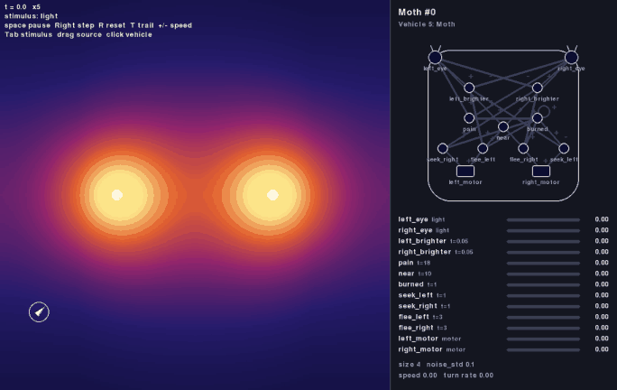
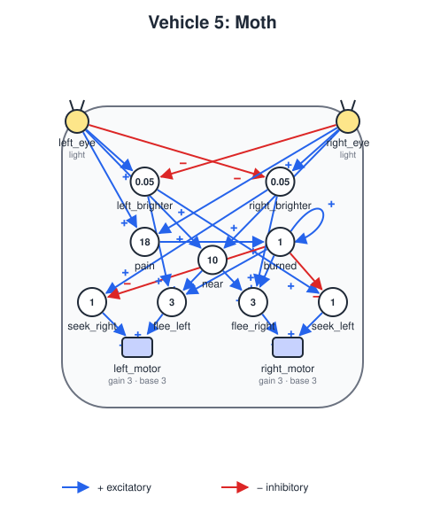
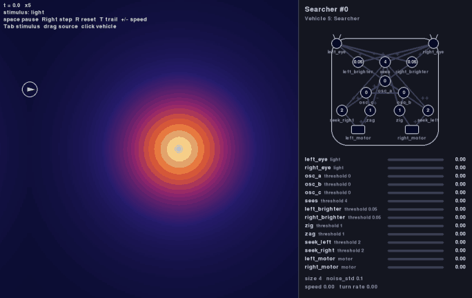
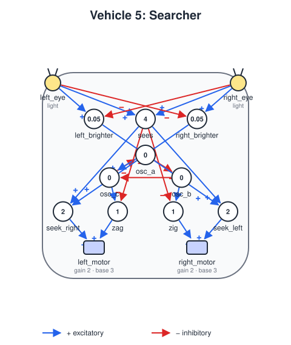
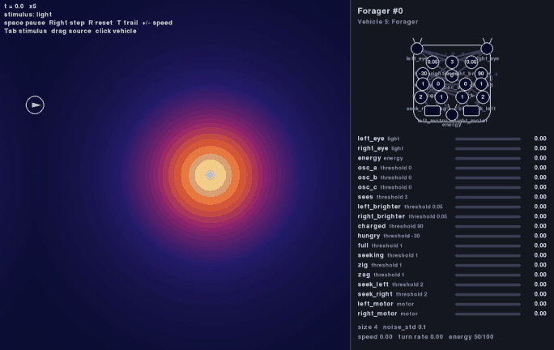
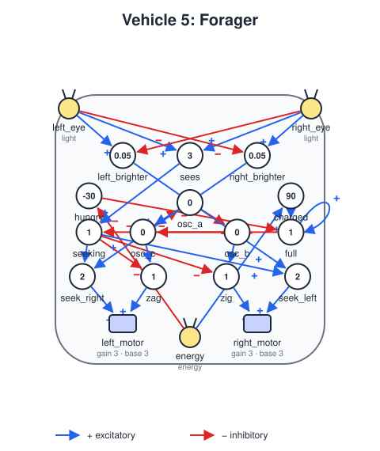
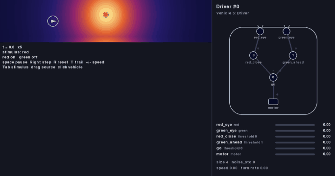
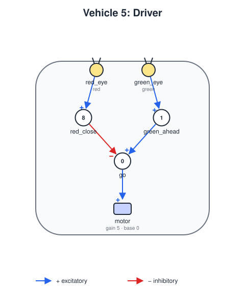

# Vehicle 5 — Logic: the Moth, the Searcher, the Forager and the Driver

## Summary

Braitenberg's chapter on Vehicle 5 ("Logic") introduces **threshold units**, the building blocks of a 'nervous system' between sensors and motors. It shows that they can be combined into logic (AND, OR, NOT) and that a unit feeding back into itself **remembers**. It does not describe a specific vehicle wired with them, so this project defines its own examples:

- **The moth** (this spec), which shows that a loop of units can **remember**.
- **The searcher** (see *Second example: Searcher*), which shows that a loop of units can keep a **rhythm**.
- **The forager** (see *Third example: Forager*), the searcher with an energy store: it combines a rhythm with a memory of being full.
- **The driver** (see *Fourth example: Driver*), which stops at a red traffic light: simple logic on two color sensors that only look ahead.

## First example: Moth

The example is a **moth that gets burned once**. At first it is drawn to light and steers toward it. If it ever gets too close, a *pain* unit fires and switches on a *memory* unit that feeds back into itself and stays on for good. From then on the same vehicle steers away from every light.

This shows what Vehicles 1 to 4 cannot do: **its behavior depends on its history**. Two moths in the same place, facing the same way, act in opposite ways depending on whether they have been burned.

*The default scenario, first 40 seconds (seed 0, played at twice the speed). The moth flies to the left light and gets burned at about 7.6 s: `pain`, then `burned`, light up in the panel. It flees, and around 36 s it comes back toward the same light but turns away about 18 units from it.*

## Design

Units only output 0 or 1, and connections have no weights, so a unit cannot turn an analog sensor-to-motor wire on and off. Steering is therefore done with units too: the moth compares its two eyes, and logic units decide which way to turn depending on whether it has been burned.

### Parts

- **Body:** `size` 4, `noise_std` 0.1.
- **Sensors:** `left_eye` at `[-0.9, 0.9]` and `right_eye` at `[0.9, 0.9]`, both reading `light` with a `linear` response.
- **Motors:** `left_motor` at `[-0.5, -0.6]` and `right_motor` at `[0.5, -0.6]`, with `base_speed` 3, `gain` 3 and `max_speed` 6. A motor runs at 3 and at 6 while it gets a signal, so the moth always moves and turns by speeding up one side.

### Units

| Unit | Inputs | Threshold | Fires when | Role |
|---|---|---|---|---|
| `left_brighter` | `left_eye`, inhibitory `right_eye` | 0.05 | the left eye reads at least 0.05 more than the right | Light is to the left |
| `right_brighter` | `right_eye`, inhibitory `left_eye` | 0.05 | the right eye reads at least 0.05 more than the left | Light is to the right |
| `pain` | `left_eye`, `right_eye` | 18 | both eyes together read 18 or more, very close to a light (about 8 units in `two-lights`) | Getting burned |
| `near` | `left_eye`, `right_eye` | 10 | both eyes together read 10 or more (within about 17 units in `two-lights`) | Close enough to a light to keep away from it |
| `burned` | `pain`, `burned` (itself) | 1 | `pain` fires, and from then on forever | **Memory** (a latch) |
| `seek_left` | `left_brighter`, inhibitory `burned` | 1 | light is to the left AND NOT burned | Turn toward light on the left |
| `seek_right` | `right_brighter`, inhibitory `burned` | 1 | light is to the right AND NOT burned | Turn toward light on the right |
| `flee_left` | `left_brighter`, `burned`, `near` | 3 | light is to the left AND burned AND near | Turn away from light on the left |
| `flee_right` | `right_brighter`, `burned`, `near` | 3 | light is to the right AND burned AND near | Turn away from light on the right |

The 0.05 threshold of the comparison units lets the moth go straight when the light is too far away or straight ahead. Once burned, the moth does not flee every light it can tell apart, only those that are `near`: it comes back to within about 17 units of a light before it turns away, keeping its distance rather than fleeing from afar.

### Motors

To turn left, the right motor speeds up; to turn right, the left one does.

| Motor | Inputs (all excitatory) | Speeds up to |
|---|---|---|
| `right_motor` | `seek_left`, `flee_right` | turn left: toward light on the left, or away from light on the right |
| `left_motor` | `seek_right`, `flee_left` | turn right: toward light on the right, or away from light on the left |

### Timing

Every unit has the default delay of 0.05 seconds between its inputs and its output ([vehicle-definition.md](vehicle-definition.md), *Signal flow*). The design has to live with it:

- **Steering lags by 0.1 s.** A change in which eye is brighter goes through a comparison unit and then a seek or flee unit before it reaches a motor. At 6 units per second the moth covers about 0.6 units before it reacts, so it overshoots and corrects, zigzagging slightly like a real moth. The comparison threshold must be large enough that this does not turn into a fast left-right flutter when the light is straight ahead.
- **The burn takes effect 0.15 s after the pain.** The eyes cross the pain threshold, `pain` turns on 0.05 s later, `burned` 0.05 s after that, and the flee units take over another 0.05 s later. Meanwhile the moth keeps flying toward the light, so it may fly over it before turning away. That is fine: it only needs to be close for long enough to latch.
- **The memory holds.** `burned` feeds back into itself, and since it sees its own output, once on it stays on. A brief `pain` signal is enough: it only has to last one delay for `burned` to latch.
- **Inputs close in time count together.** A unit treats inputs that arrive less than its delay apart as simultaneous. For the seek and flee units this means a comparison and a change in `burned` that reach them within 0.05 s of each other are combined, so the moth switches cleanly from seeking to fleeing instead of taking one step in the old direction.
- **Time step.** With the default `dt` of 0.05 s, a 0.05 s delay is a single step and the simultaneity window covers only the current step, so neither has any visible effect. The moth's scenario therefore uses `dt` 0.01 s: each delay is 5 steps, and the window covers the last 5 steps.
- **Every unit starts at 0**, including `burned`, so a new moth has never been burned.

### Diagram

The diagram places the units in rows between the eyes and the motors: comparison units near the eyes, then `pain`, `near` and `burned` in the center, then the seek and flee units near the motors. With 2 sensors, 9 units and 2 motors, the panel must show all readouts without running off the window ([vehicle-diagram.md](vehicle-diagram.md) gives one compact line per part).

The values above are the starting design. Implementation may tune them (as with Vehicles 3 and 4) to make the behavior clear, and then updates this spec.

## Definition, world and scenario

- `vehicles/vehicle5-moth.yaml`: the definition above.
- `worlds/two-lights.yaml`: a 100×100 wrapping arena with two lights far enough apart that the moth can be near one and far from the other, e.g. at `[30, 50]` and `[70, 50]`, intensity 10, falloff 15.
- `scenarios/vehicle5-moth.yaml`: one moth in `two-lights` at `[10, 20]`, heading 45°, so it reaches a light early in the run, with `dt` 0.01 (see *Timing*).

## Acceptance criteria

All behavior criteria use the default scenario, run headless for 200 seconds of simulated time (20,000 steps at `dt` 0.01), and must hold for each of seeds 0 to 4. Times below are in simulated seconds.

1. **Drawn to light:** the moth gets burned (`burned` turns on) within the first 75 seconds.
2. **Remembers:** once `burned` is on, it stays on for the rest of the run, including when the moth is far from every light and `pain` is off.
3. **Keeps its distance after:** starting 10 seconds after it was burned, the moth never comes within 15 units of any light, although it came within 10 units of one before; and it does come back within 25 units of a light at least once.
4. **Logic:** unit by unit, given chosen eye readings and a `burned` state, once the unit's 0.05 s delay has passed:
   - `left_brighter` and `right_brighter` fire only when one eye reads at least 0.05 more than the other, and never both at once;
   - `near` fires exactly when the eyes together read 10 or more;
   - `seek_left` fires exactly when `left_brighter` is on and `burned` is off, and `flee_left` exactly when `left_brighter`, `burned` and `near` are all on (the same for the right side);
   - `burned` stays at 0 until `pain` fires, then stays at 1.
5. **Simultaneity:** a unit fires on two inputs that arrive less than its delay apart (with `dt` 0.01, up to 4 steps apart) and not on inputs 5 or more steps apart.
6. **Delays:** after the eyes first read 18 or more together, `pain` turns on 0.05 s later and `burned` 0.1 s later, and the moth's motors start fleeing 0.15 s later. A change in which eye is brighter reaches the motors 0.1 s later.
7. **History matters:** two moths with the same definition, one never burned and one burned, start at the same position and heading in `worlds/one-light.yaml`, 13 units from the light (within `near`) with the light 27° to one side (`dt` 0.01). They steer in opposite directions: after 0.5 s the first faces the light more directly than at the start and the second less, and after 1.5 s the first is closer to the light than at the start and the second farther.

## Out of scope

- Unlearning: once burned, the moth never trusts light again. (Forgetting needs connections whose strength changes over time. The wary moth of Vehicle 7, [vehicle-07.md](vehicle-07.md), learns which lamp burns and unlearns it when the lamp cools.)
- Options B (logical AND of two stimuli) and C (counting encounters) from the design discussion. They can be later Vehicle 5 examples.

## Second example: Searcher

*The searcher's default scenario, first 20 seconds (seed 0, played at twice the speed). In the panel, `osc_b` and `osc_c` take turns until `sees` lights up; from then on `seek_left` and `seek_right` steer.*

While the searcher sees no light, a small oscillator of three units makes it **zigzag**, turning left and right in turn, as a moth does when it has lost the trail of a scent and sweeps the air to find it again. As soon as a light is in sight, the oscillator is silenced and the searcher steers straight to the light.

The oscillator is a ring of three units, each silenced by the one before it (`osc_a` ← `osc_c` ← `osc_b` ← `osc_a`), with a delay of 0.3 s each. A single unit that silences itself would also oscillate, but unevenly: the simultaneity window holds it off for twice as long as it is on, so the vehicle would turn in circles. In the ring, `osc_b` and `osc_c` are each on for the same time in every cycle, so the turns to each side are equal and the zigzag keeps its overall direction. An extra excitatory connection from `osc_a` to `osc_c` keeps the three units from starting, and staying, in step.

The full design, the definition (`vehicles/vehicle5-searcher.yaml`), the scenario (`scenarios/vehicle5-searcher.yaml`) and the searcher's acceptance criteria are in [vehicle-05-searcher.md](vehicle-05-searcher.md).

## Third example: Forager

*The forager's default scenario, first 90 seconds (seed 0, played at four times the speed). Watch `energy`, `full` and `seeking` in the panel.*

The forager is the searcher with an **energy** store ([vehicle-definition.md](vehicle-definition.md), *5. Energy*): moving uses it up, and being near the light recharges it. A sensor of type `energy` lets the forager sense its own energy. While hungry it searches and goes to the light like the searcher; there it recharges. Once **full** it zigzags away to explore, even with the light in sight, until it is hungry again.

A unit that feeds back into itself remembers being full, as the moth's `burned` remembers the burn: `full` turns on when the energy reaches 90 (`charged`) and stays on until it falls to 30 (`hungry`). Without that memory, the forager would leave the light as soon as its energy crossed a single line, turn back as soon as it dropped below it, and hover at the edge.

The full design, the definition (`vehicles/vehicle5-forager.yaml`), the scenario (`scenarios/vehicle5-forager.yaml`) and the forager's acceptance criteria are in [vehicle-05-forager.md](vehicle-05-forager.md).

## Fourth example: Driver

*The driver's default scenario, first 60 seconds (played at four times the speed). The road loops, so the driver comes back to the light on every lap: it stops at red, passes on green, and stops again.*

The driver moves only in a straight line, at a constant speed, along a road with a traffic light beside it. It has two color sensors, `red_eye` and `green_eye`, and three units: `red_close` fires when a red light is close ahead, `green_ahead` when a green one is in sight, and `go`, which fires on its own, keeps the motor running unless a red light is close and no green one is seen. So it stops a few units before a red light, waits, and goes on as soon as the light turns green; on green it passes at full speed.

It relies on two features of the simulator: the traffic light is two sources that switch on and off on a schedule ([worlds.md](worlds.md), *Schedules*), and the eyes have a 90° field of view ([vehicle-definition.md](vehicle-definition.md), *Field of view*), so a light the driver has already passed no longer stops it.

The full design, the definition (`vehicles/vehicle5-driver.yaml`), the world (`worlds/traffic-light.yaml`), the scenario and the driver's acceptance criteria are in [vehicle-05-driver.md](vehicle-05-driver.md).
