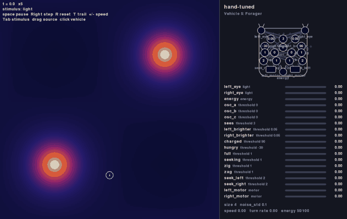
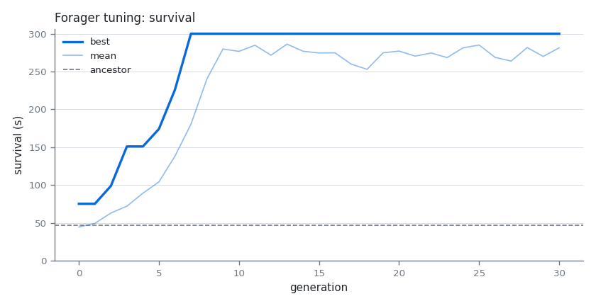
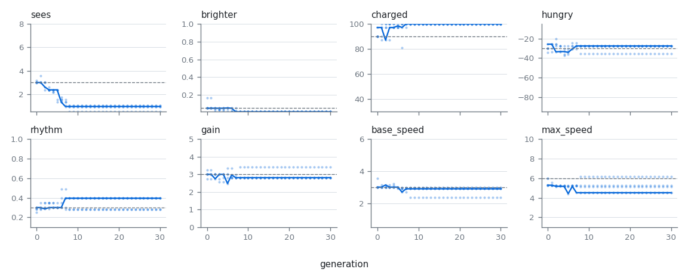

# Vehicle 6 — Selection: tuning the forager

## Summary

Braitenberg's chapter on Vehicle 6 ("Selection, the impersonal engineer") puts many vehicles on a table. From time to time one is picked up and copied, and the copier makes small mistakes. Vehicles that fall off the table are lost and never copied again. Nobody judges the vehicles or understands their wiring; still, after a while the ones on the table are better at staying there than the first ones were. Selection does the engineering.

This project applies that idea to a vehicle whose numbers were chosen by hand: the **forager** ([vehicle-05-forager.md](vehicle-05-forager.md)). Its brain is fixed (which unit is wired to which), but its numbers are a guess: the threshold at which it sees a light, the energy at which it is full and at which it is hungry again, the rhythm of its zigzag, the speed of its motors. Vehicle 6 lets selection tune them:

- **Falling off the table is running out of energy.** A forager whose energy reaches 0 is dead. How long it lasted is the only thing selection looks at; there is no score written by the designer for "good foraging".
- **Copying errors are small random changes** to a chosen set of numbers, the **genes**, each within a range.
- **The survivors are copied.** In each generation, the foragers that lasted longest are kept and copied with errors; the rest are lost.

The result is a new definition file: the same forager with evolved numbers, which can be watched next to the original.

Out of the four sources of variation Braitenberg mentions, this spec covers only copying errors in numbers. Changes to the wiring itself (adding or removing units and connections) and the crossing of two parents are out of scope.

## Why the forager needs tuning

In `worlds/one-light.yaml`, starting at `[10, 70]` heading 0, the hand-tuned forager recharges again and again. Started at random places and headings, it often does not: it zigzags away and runs out of energy before the light is in sight. A rough measurement (10 random starts, 300 s, `dt` 0.01) of the time until the energy reaches 0:

| World | Hand-tuned | `sees` threshold 1.5 | `sees` threshold 1 |
|---|---|---|---|
| `one-light` (100 × 100, one light) | median 88 s, 3 of 10 alive at 300 s | median 300 s, 6 of 10 | 10 of 10 |
| two far lights (200 × 200) | median 50 s, 0 of 10 | median 137 s, 2 of 10 | median 170 s, 2 of 10 |

One number changes the outcome by a factor of three, and the best value is not obvious in advance (a `sees` threshold of 1 means seeing a light from almost anywhere, which silences the zigzag). The larger world is used for evolution because no single change saturates it.

## The world

`worlds/far-lights.yaml`: a 200 × 200 arena with `edges: wrap` and two lights of `intensity` 10 and `falloff` 15, at `[50, 50]` and `[150, 150]`. On the torus each light is about 141 units from the other in every direction, so a forager that leaves one light must cross a long dark stretch to find the next one.

## The evolution file

An evolution run is described in a YAML file in the `evolutions/` folder. Like the other files, it says what to run and leaves the mechanism to the code.

```yaml
name: Forager tuning
description: Tune the forager's numbers by survival in a world with two far lights.

ancestor: ../vehicles/vehicle5-forager.yaml
world: ../worlds/far-lights.yaml

population: 20               # vehicles per generation
survivors: 5                 # how many are kept and copied
generations: 30
seed: 0                      # mutation and trial starts

trials:
  count: 5                   # each vehicle is tried this many times, alone
  duration: 300              # seconds; a vehicle alive at the end lasted 300
  dt: 0.01
  validation: 20             # extra trials, never used for selection, to check the result

mutation:
  rate: 0.3                  # chance that each gene changes in a copy

genes:
  - gene:
      name: sees
      targets: [units.sees.threshold]
      min: 0.5
      max: 8
      sigma: 0.5
  - gene:
      name: brighter
      targets: [units.left_brighter.threshold, units.right_brighter.threshold]
      min: 0.01
      max: 1
      sigma: 0.05
  - gene:
      name: charged
      targets: [units.charged.threshold]
      min: 30
      max: 100
      sigma: 5
  - gene:
      name: hungry
      targets: [units.hungry.threshold]
      min: -95
      max: -5
      sigma: 5
  - gene:
      name: rhythm
      targets: [units.osc_a.delay, units.osc_b.delay, units.osc_c.delay]
      min: 0.1
      max: 1
      sigma: 0.05
  - gene:
      name: gain
      targets: [actuators.left_motor.gain, actuators.right_motor.gain]
      min: 0
      max: 5
      sigma: 0.3
  - gene:
      name: base_speed
      targets: [actuators.left_motor.base_speed, actuators.right_motor.base_speed]
      min: 0.5
      max: 6
      sigma: 0.3
  - gene:
      name: max_speed
      targets: [actuators.left_motor.max_speed, actuators.right_motor.max_speed]
      min: 1
      max: 10
      sigma: 0.5
```

| Key | Required | Meaning |
|---|---|---|
| `name`, `description` | `name` required | Human-readable. |
| `ancestor` | yes | The vehicle definition that generation 0 starts from. |
| `world` | yes | The world every trial runs in. |
| `population` | yes | Vehicles per generation, at least 2. |
| `survivors` | yes | Vehicles kept from each generation, at least 1 and less than `population`. |
| `generations` | yes | How many generations to run after generation 0. Can be overridden on the command line. |
| `seed` | no | Seeds the mutations and the trial starts. Default 0. |
| `trials` | yes | `count` (at least 1), `duration` (seconds, positive), `dt` (default 0.05) and `validation` (default 0). |
| `mutation` | no | `rate`, from 0 to 1. Default 0.3. |
| `genes` | yes | A list, each item wrapped in `- gene:`. At least one. |

Each gene:

| Key | Required | Meaning |
|---|---|---|
| `name` | yes | Unique among the genes; used in the log and the plot. |
| `targets` | yes | The numbers in the definition that this gene sets, as `units.<name>.<key>`, `actuators.<name>.<key>` or `sensors.<name>.response.<key>`. All targets of a gene always hold the same value, so a pair of motors stays a pair and the three oscillator units keep one rhythm. |
| `min`, `max` | yes | The range of the gene, `min < max`. |
| `sigma` | yes | Size of a copying error (see *Copying*). Positive. |

Allowed keys: for units `threshold` and `delay`; for actuators `gain`, `base_speed` and `max_speed`; for sensor responses `at`, `width` and `height`. Nothing else can be a gene. In particular the `energy` section (how much moving costs, how fast light recharges) and the body `size` belong to the world's physics, not to what the vehicle can change: a forager allowed to evolve `consumption` would simply set it to 0.

A gene's starting value is the value its targets have in the ancestor. If the targets of a gene start with different values, or the starting value is outside `[min, max]`, loading fails.

### Loading and validation

As with the other files: `yaml.safe_load`, validation into dataclasses, and fail fast with a message naming the file and the key when:

- a required key is missing, has the wrong type, or an unknown key appears;
- an item in `genes` is not wrapped in `- gene:`;
- `ancestor` or `world` does not exist or is invalid (the message names the referenced file and key, as for scenarios);
- the ancestor does not fit the world (as checked for scenarios, [scenarios.md](scenarios.md));
- a gene name is repeated, a target names a part the ancestor does not have or a key that is not allowed, `min` is not below `max`, or `sigma` is not positive;
- a gene's targets start with different values, or outside `[min, max]`;
- `population`, `survivors`, `trials` or `mutation.rate` are out of range.

## Running an evolution

### Genomes

A **genome** is one value per gene. Applying a genome to the ancestor gives a vehicle definition: a copy of the ancestor with each gene's targets set to the gene's value. Nothing else changes: the wiring, the positions, the sensors and the energy section are the ancestor's.

### Copying

A copy of a genome is made gene by gene: with probability `mutation.rate` the gene changes by a random amount drawn from a normal distribution with mean 0 and standard deviation `sigma`; then it is clipped to `[min, max]`. Otherwise it is copied exactly. A copy may come out identical to its parent.

### Trials

At the start of the run, the trial starts are drawn once from a generator seeded with `seed`: `count` starts for selection and `validation` more for checking. Each start is a position uniform over the arena and a heading uniform in `[0, 360)` degrees. Trial `k` also has its own simulation seed, `k`, for the vehicle's noise.

A **trial** places one vehicle alone in the world at one start, with its `energy.initial`, and runs the simulation ([scenarios.md](scenarios.md)) with `trials.dt`. The trial ends when the vehicle's energy reaches 0, at the end of the step where it happens, or at `duration`. Its result is the **survival time**: the simulation time at which the trial ended. A vehicle still alive at the end lasted `duration`.

This is the only place where running out of energy matters. Elsewhere, as in [vehicle-definition.md](vehicle-definition.md), a vehicle with no energy keeps moving.

A vehicle's **survival** is the mean of its survival times over the selection trials. All vehicles of all generations face the same selection trials, so they are compared fairly and a genome always gets the same survival. (A run can cache it.)

### Generations

- **Generation 0** is the ancestor's genome and `population - 1` copies of it.
- Every vehicle of a generation is tried, and the generation is **ranked** by survival, longest first. Ties keep their order in the generation.
- The next generation is the `survivors` best, unchanged and in rank order, followed by `population - survivors` copies: copy `i` (from 0) is made from survivor `i mod survivors`.

Because the survivors are kept unchanged and always face the same trials, the best survival never decreases from one generation to the next.

All randomness of copying comes from one generator seeded with `seed`, used in a fixed order. A run is therefore fully determined by the evolution file. Trials may run in parallel processes; the number of processes does not change the results.

After the last generation, the best vehicle and the ancestor are also run on the validation trials. Their validation survival is reported but never used for selection: it shows whether the evolved forager is better in general or only at the starts it was selected on.

### Command line

```
python -m braitenberg.evolve evolutions/forager.yaml
python -m braitenberg.evolve evolutions/forager.yaml --generations 5 --workers 8 --out runs/forager
```

| Option | Meaning |
|---|---|
| `--generations N` | Override `generations`. |
| `--seed N` | Override `seed`. |
| `--workers N` | Processes to run trials in. Default: the number of CPUs. |
| `--out DIR` | Where to write the results. Default: `runs/<evolution file name>/`. The `runs/` folder is not committed. |

While it runs it prints one line per generation: the generation, its best and mean survival, and the best genome.

### Results

The output folder holds:

| File | Content |
|---|---|
| `log.csv` | One row per vehicle per generation: `generation`, `rank`, `parent` (rank in the previous generation, empty for generation 0 and for the ancestor), `survival`, and one column per gene. |
| `best.yaml` | The best vehicle of the last generation, as a vehicle definition file: the ancestor with the best genome applied, `general.name` followed by ` (evolved)`, and a `description` naming the evolution file, the seed and the generation. Comments in the ancestor are not kept. |
| `summary.yaml` | The evolution file's name and seed, the number of generations, the best genome, and the survival and validation survival of the ancestor and of the best vehicle. |
| `survival.png` | A plot (matplotlib): best and mean survival per generation, with the ancestor's survival as a horizontal line. |
| `genes.png` | A plot: for each gene, the value in each survivor per generation, on the gene's range from `min` to `max`. It shows which numbers selection pushed and which it left alone. |

## Definition and scenario

- `worlds/far-lights.yaml`: the world above.
- `evolutions/forager.yaml`: the evolution file above.
- `vehicles/vehicle6-forager.yaml`: the `best.yaml` of a run of `evolutions/forager.yaml` with seed 0, committed, with `general.type` `"6"`.
- `scenarios/vehicle6-forager.yaml`: the original and the evolved forager side by side in `worlds/far-lights.yaml`, starting from the same point with the same heading, labeled `hand-tuned` and `evolved`. The vehicles do not collide, so each behaves as it would alone.

## The committed run

`python -m braitenberg.evolve evolutions/forager.yaml` (seed 0, 30 generations, about two minutes on 10 processes).



*The default scenario, first 30 seconds (seed 0, played at twice the speed). The panel shows the hand-tuned forager: its energy reaches 0 at about 16 s, still zigzagging in the dark, while the evolved one has already found the lower light. (Outside a trial a vehicle with no energy keeps moving, so the hand-tuned one may still stumble onto a light later; in a trial it would be dead.)*



The best survival rises from 75 s in generation 0 to the full 300 s in generation 7, and the mean follows. From then on the best vehicles last the whole trial at every start, so they all tie and selection has nothing left to choose between them: the best genome stays the same. A longer `duration` or harder starts would be needed to push further.



| Gene | Hand-tuned | Evolved |
|---|---|---|
| `sees` | 3 | 0.95 |
| `brighter` | 0.05 | 0.01 (its minimum) |
| `charged` | 90 | 100 (its maximum) |
| `hungry` | -30 | -27.6 |
| `rhythm` | 0.3 | 0.40 |
| `gain` | 3 | 2.81 |
| `base_speed` | 3 | 2.90 |
| `max_speed` | 6 | 4.52 |

| Survival | Hand-tuned | Evolved |
|---|---|---|
| Selection trials (5) | 47 s | 300 s |
| Validation trials (20) | 74 s | 294 s |

Selection changed mostly what the forager can see. In `far-lights` the light is about 0.86 even at the darkest points, halfway between the lights, so with `sees` at 0.95 the two eyes together (about 1.7) always cross the threshold: the forager sees a light from everywhere in the arena. It never zigzags while hungry, and goes straight to a light; `brighter` at its minimum lets it steer on the faintest difference between its eyes. The zigzag is left only for when it is full, to wander away from the light it just used. It also fills up completely (`charged` at 100) before leaving. The motors became a little slower, which makes that zigzag narrower. The hunger level hardly moved.

Selection found what a designer might have done in a few seconds of thought: if light can be seen from everywhere, searching is a waste. But it found it without anyone knowing the field, only by keeping the foragers that lasted. On the 20 starts it was never selected on, the evolved forager lasts four times as long as the hand-tuned one.

## Acceptance criteria

The criteria that need a full run (6 and 7) use `evolutions/forager.yaml` as committed; the others use small evolution files written for the tests (small population, few short trials, a large `dt`) so they run in seconds.

1. **Load:** loading the example evolution file produces the ancestor, the world, the settings and the genes, with each gene's starting value taken from the ancestor.
2. **Validation:** each failure case under *Loading and validation* raises an error naming the file and the key.
3. **Genomes:** applying a genome sets every target of every gene to the gene's value and changes nothing else in the definition. Applying the ancestor's genome gives a definition equal to the ancestor.
4. **Copying:** copies stay within each gene's range. With `rate` 0 a copy equals its parent; with `rate` 1 every gene changes, and over many copies the changes of a gene far from its limits have mean about 0 and standard deviation about `sigma`.
5. **Trials:** a trial ends at the step where the energy reaches 0, and its survival time is that step's time; a vehicle that never runs out lasts `duration`. A vehicle with `consumption` 0 lasts `duration`; one with no `charge_from` and a constant speed dies at `initial / (consumption * speed)`, within one step.
6. **Selection:** in each generation the survivors are the best by survival, they appear unchanged in the next generation, every other vehicle is a copy of a survivor following the rule above, and the best survival never decreases.
7. **Determinism:** two runs of the same evolution file write identical `log.csv` and `best.yaml`, with 1 worker and with several.
8. **It works:** after a run of `evolutions/forager.yaml` with seed 0, the evolved forager's validation survival is at least twice the ancestor's. (The rough measurement above suggests the room is there: the hand-tuned forager lasts about 50 s and a better `sees` threshold alone about 150 s.)
9. **Results:** a run writes the files listed under *Results*; `best.yaml` loads as a valid definition equal, apart from `general`, to the ancestor with the best genome applied; `summary.yaml` matches the last generation of `log.csv`.
10. **Headless:** loading and running an evolution never imports pygame.

Criterion 8 runs for a few minutes; its test is marked `slow` and skipped unless `pytest -m slow` is given.

## Out of scope

- Selection inside a shared world, as on Braitenberg's table: many vehicles at once, removed when they die and copied while they live. This spec tries each vehicle alone, which is faster and easier to compare; a live "table" could be added later on top of the same genomes and copying.
- Changing the wiring: adding or removing units or connections, or turning connections on and off through their `strength`.
- Crossing two parents.
- Evolving the body, the sensors' positions or the energy section.
- Vehicles that interact (competing for the same light, colliding).
