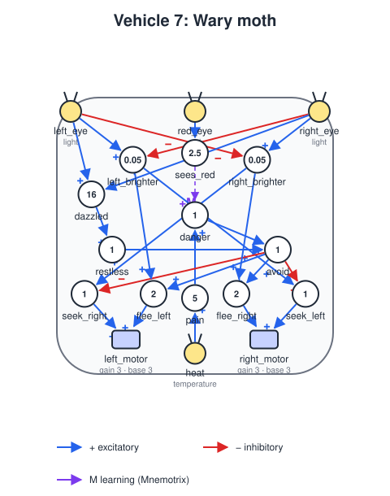

# Vehicle 7 — Concepts: the wary moth

## Summary

Braitenberg's chapter on Vehicle 7 ("Concepts") adds a new kind of wire, the **Mnemotrix**. It starts out weak, so it carries no signal. Whenever the two parts it connects are active together, it gets stronger. Once it is strong enough, activating one part also activates the other. Things that kept happening together in the vehicle's experience become linked inside it, and seeing one of them calls up the other. Braitenberg calls such a linked group a **concept**.

This spec adds learning connections to the vehicle definition and uses them in one example, the **wary moth**. It is drawn to every lamp, like the Vehicle 5 moth. Some lamps are hot as well as bright, and they are also red. At first the wary moth flies into the red lamp and gets burned. Each burn happens while it sees red, so a Mnemotrix wire from *sees red* to *danger* grows. After a burn or two, seeing red is enough to make it turn away, while it keeps visiting the white lamp. When the red lamp cools down, the moth sees red with no burn, the wire weakens again, and it goes back to the red lamp.


*The default scenario, first 180 seconds (seed 0, played at eight times the speed). The moth is burned at 2 s and the wire `sees_red->danger`, at the bottom of the panel, passes 0.7 at 9 s. From then on it turns away about 25 units from the red lamp, and is burned now and then when the wire has faded, which tops it up again (16 s, 50 s). The lamp goes cold at 120 s (`temperature off` at the top left); by then the wire has faded, and from 130 s the moth flies through the red lamp again and again.*

Compare this with the Vehicle 5 moth ([vehicle-05.md](vehicle-05.md)). Its memory is a latch: after one burn it fears **every** light, **forever**. The wary moth learns **which** lamp hurts, from **repeated** experience, and **unlearns** that when the world changes. Before Vehicle 7 this was impossible, because connections could not change while the vehicle ran.

## Learning connections

### The rule

A learning connection is an ordinary input ([vehicle-definition.md](vehicle-definition.md), *Inputs*) with a `learning` section. Its `strength` is now a starting value that changes while the vehicle runs. As before, it is a gate and not a weight: the connection carries its source's full signal while its strength is above `0.7`, and nothing at or below it.

```yaml
- unit:
    name: danger
    type: threshold
    threshold: 1
    inputs:
      - input:
          from: pain             # fixed: pain always means danger
      - input:
          from: sees_red
          strength: 0            # starts inactive
          learning:
            type: mnemotrix
            learn: 0.5           # strength gained per second while sees_red fires and danger is driven by its other inputs
            forget: 0.02         # strength lost per second while sees_red fires and danger is not
```

Each step, every Mnemotrix connection from a source `S` to a unit `D` looks at two things:

- **Is the source on?** `S`'s contribution in `D`'s simultaneity window (the value `D` uses for its activation, see *Signal flow*) is 1.
- **Is the destination driven by its other inputs?** The sum of `D`'s **other** active inputs, computed as for its activation, reaches `D`'s threshold. "Other" leaves out this connection.

Then:

| Source | Destination driven by other inputs | Strength |
|---|---|---|
| on | yes | `+= learn * dt` (they happened together: **learn**) |
| on | no | `-= forget * dt` (the source happened alone: **forget**) |
| off | either | unchanged |

The strength is clipped to `[0, 1]`.

**Why "other inputs".** Braitenberg's wire strengthens whenever both of its ends are active. In this project a connection that has crossed `0.7` makes its destination fire by itself. If that counted as "both active", every learned association would keep confirming itself, and nothing could ever be unlearned: the wary moth would turn away from red at a distance, so it would never find out that the lamp had gone cold. Leaving out the connection's own contribution means the wire learns from what the **rest** of the brain says about the destination: whether danger was there for some other reason (pain) at the times the source fired.

**Why nothing changes while the source is off.** A memory should not fade just because the cue is absent. The wary moth on the far side of the arena should still fear red when it comes back. It forgets only by seeing red and being proved wrong, which is extinction in the psychologist's sense.

### Keys

| Key | Required | Meaning |
|---|---|---|
| `type` | yes | `mnemotrix`, the only learning type for now. |
| `learn` | yes | Strength gained per second while the source fires together with the destination's other inputs. Not negative. |
| `forget` | no | Strength lost per second while the source fires without them. Not negative. Default 0: an association, once made, is never lost. |

The input's `strength` (default `1`) is the starting strength. A learning connection may be excitatory or inhibitory; the rule is the same. An inhibitory Mnemotrix wire learns that "when the source fires, the destination should be off", as long as the destination's other inputs keep firing it at those times.

Restrictions:

- A learning connection's source must be a **unit**, not a sensor. A unit is either on or off, so "the source is on" is well defined. A sensor that should take part goes through a threshold unit first, as `red_eye` goes through `sees_red` below.
- Its destination must be a **unit**, not an actuator: "driven by its other inputs" needs a threshold.
- A unit may not learn from itself.

### Signal flow

The step in [vehicle-definition.md](vehicle-definition.md), *Signal flow*, gains a part at the end of step 2:

2. **Units**, in three parts: **outputs**, **activations** (unchanged), then **learning**. Each learning connection updates its strength from the values just used for the activations: the source's contribution in the destination's window, and the destination's other inputs. The new strength takes effect from the next step. Within a step, a connection is active or not as decided by its strength at the start of the step.

The rule needs no knowledge of the delays: it compares what the destination saw, so a source and a destination input that arrive less than the destination's `delay` apart count as together, as they do for firing.

### Strength at run time

- Each vehicle starts with the strengths in its definition. Two vehicles from the same definition learn separately.
- Learning changes only the running vehicle, never the definition file. Restarting a scenario starts from the file's strengths.
- Connections without `learning` never change. Every vehicle defined so far behaves exactly as before.

### Loading and validation

In addition to the cases in [vehicle-definition.md](vehicle-definition.md), *Loading and validation*, loading fails, naming the file and the key, when:

- `learning` has an unknown `type`, is missing `learn`, has an unknown key, or has `learn` or `forget` negative or not a number;
- a learning connection's `from` names a sensor, or its destination is an actuator;
- a unit has a learning connection from itself.

## The wary moth

### The world

`worlds/hot-lamp.yaml`: a 100 × 100 arena with `edges: wrap` and two lamps 40 units apart, as in `two-lights`:

| Stimulus | Sources | Meaning |
|---|---|---|
| `light` | `[30, 50]` and `[70, 50]`, intensity 10, falloff 15 | Both lamps shine. |
| `red` | `[70, 50]`, intensity 10, falloff 15 | The right lamp is red. |
| `temperature` | `[70, 50]`, intensity 10, falloff 4, `schedule: {period: 240, on_at: 0, off_at: 120}` | The red lamp is hot for 120 s, cold for 120 s, and so on. |

The heat falls off much faster than the light: it is only felt within a few units of the lamp, while the red can be seen from far away. Since the red lamp is always red, red predicts heat only while the lamp is hot.

### Design



#### Parts

- **Body:** `size` 4, `noise_std` 0.3. The noise is higher than the Vehicle 5 moth's 0.1 so that the moth wanders from one lamp to the other instead of settling into the same circuit around one of them.
- **Sensors:** `left_eye` at `[-0.9, 0.9]` and `right_eye` at `[0.9, 0.9]`, both reading `light`; `red_eye` at `[0, 0.9]` reading `red`; `heat` at `[0, -0.85]` reading `temperature`.
- **Motors:** `left_motor` at `[-0.5, -0.75]` and `right_motor` at `[0.5, -0.75]`, `base_speed` 3, `gain` 3, `max_speed` 6, as for the Vehicle 5 moth.

#### Units

| Unit | Inputs | Threshold | Fires when | Role |
|---|---|---|---|---|
| `left_brighter` | `left_eye`, inhibitory `right_eye` | 0.05 | the left eye reads at least 0.05 more | A lamp is to the left |
| `right_brighter` | `right_eye`, inhibitory `left_eye` | 0.05 | the right eye reads at least 0.05 more | A lamp is to the right |
| `sees_red` | `red_eye` | 2.5 | red reads 2.5 or more, within about 26 units of the red lamp | Red in sight |
| `pain` | `heat` | 5 | heat reads 5 or more, within 4 units of a hot lamp | Getting burned |
| `danger` | `pain`; `sees_red` (**Mnemotrix**, strength 0, `learn` 0.5, `forget` 0.02) | 1 | `pain`, or `sees_red` once learned | The concept "hot red lamp" |
| `dazzled` | `left_eye`, `right_eye` | 16 | both eyes together read 16 or more, within about 7.5 units of a lamp | Right at a lamp |
| `restless` | `dazzled`, `delay` 2 | 1 | from 2 s after `dazzled` first fires until 4 s after it last fired | Time to leave this lamp |
| `avoid` | `danger`, `restless` | 1 | `danger` OR `restless` | Keep away from lamps |
| `seek_left` | `left_brighter`, inhibitory `avoid` | 1 | lamp to the left AND NOT avoid | Turn toward it |
| `seek_right` | `right_brighter`, inhibitory `avoid` | 1 | lamp to the right AND NOT avoid | Turn toward it |
| `flee_left` | `left_brighter`, `avoid` | 2 | lamp to the left AND avoid | Turn away from it |
| `flee_right` | `right_brighter`, `avoid` | 2 | lamp to the right AND avoid | Turn away from it |

The motors are wired as in the moth: `right_motor` takes `seek_left` and `flee_right`, and `left_motor` takes `seek_right` and `flee_left`.

#### Leaving a lamp

A moth that only seeks lamps reaches the first one and circles over it for good, so it never meets the other lamp and has nothing to learn. `dazzled` and `restless` make it leave: once it has been at a lamp for 2 s, `restless` turns on and the moth flees, and it keeps fleeing until 4 s after it was last dazzled, about 25 units away. Then it seeks again, whichever lamp is brightest from there, which is sometimes the other one.

`restless` gets its long reaction time from its 2 s `delay` ([vehicle-definition.md](vehicle-definition.md), *Signal flow*): its output is what its input called for 2 s earlier, and since inputs within its delay count as simultaneous, it stays on 2 s past the last `dazzled`.

`restless` does not go through `danger`: leaving a lamp because it has been there a while is not a reason to fear it, so it must not teach the Mnemotrix wire anything. Leaving the white lamp never makes red mean danger.

The moth leaves the red lamp after 2 s whether it is hot or not, but by then it has been burned long enough to learn.

#### How it learns

- **Before learning** `sees_red → danger` is inactive, so `danger` fires only with `pain`. The wary moth flies into the red lamp like any lamp, gets burned, flees, and comes back, as the Vehicle 5 moth would if it had no latch.
- **Each burn teaches.** While it is burned it is within 4 units of the red lamp, well inside the 26 units of `sees_red`, so the source is on and `danger` is driven by `pain`: the strength grows by 0.5 per second. About 1.4 s of burning in total, usually one or two visits, takes it past 0.7.
- **Once learned**, `danger` fires as soon as red is in sight, and the moth turns away about 26 units from the red lamp, before it is burned. It keeps seeking the white lamp, which is 40 units from the red one and out of red sight.
- **Checking costs a little.** Each time the moth sees red and turns away without a burn, the strength drops by 0.02 per second. A strength just learned, near 0.75, survives only a few seconds of red without pain, and one at 1 about 15 s. So while the lamp is hot, the moth now and then forgets, goes in, is burned, and learns again: it keeps checking, and each check costs a short burn.
- **Unlearning.** Once the lamp is cold, nothing tops it up. After enough red without pain the connection drops to 0.7 or below. From then on, the moth flies into the red lamp again, and, finding no heat, keeps forgetting. When the heat returns, it relearns.

The ratio of `learn` to `forget` is the main lever: it sets how many seconds of red without pain one second of burn pays for. The values were tuned on seeds 0 to 14 so that every criterion below holds for all of them: a smaller `forget` (0.015) sometimes kept the moth from unlearning within a cold phase, and a larger one (0.03) made it forget faster than it could find the white lamp.

#### Diagram and panel

Learning connections are drawn so that learning can be watched ([vehicle-diagram.md](vehicle-diagram.md) is updated to match):

- **Wire:** a Mnemotrix wire is drawn with its own color and labeled `M`. Its width grows with its current strength, and it is dashed while inactive, so the moment it switches on is visible.
- **Readouts:** one extra line per learning connection, such as `sees_red->danger  M  0.42`, with a strength bar from 0 to 1 and a tick at 0.7.
- **Static SVG:** the wire is drawn with its starting strength, and the legend explains `M`.
- **Window:** with 18 parts and a strength line, the readouts would leave little room for the diagram, so the window grows taller than the arena when a vehicle needs it.
- **Lamps:** the red lamp is drawn red even while it is hot, and the top left of the arena says whether `temperature` is on or off.

## Definition, world and scenario

- `vehicles/vehicle7-wary-moth.yaml`: the definition above, `general.type` `"7"`.
- `worlds/hot-lamp.yaml`: the world above.
- `scenarios/vehicle7-wary-moth.yaml`: one wary moth in `hot-lamp` at `[70, 15]`, heading 90° (straight toward the red lamp, so the first lesson comes within seconds), `dt` 0.01.
- `specs/images/vehicle7-wary-moth.svg` and `specs/images/vehicle7-wary-moth.gif`: the diagram and the recording above.

```
python -m braitenberg scenarios/vehicle7-wary-moth.yaml
python -m braitenberg.diagram vehicles/vehicle7-wary-moth.yaml --out specs/images/vehicle7-wary-moth.svg
python -m braitenberg.record scenarios/vehicle7-wary-moth.yaml --seconds 180 --every 0.25 --speed 8 --scale 0.5 --out specs/images/vehicle7-wary-moth.gif
```

## Related specs

- [vehicle-definition.md](vehicle-definition.md): the `learning` key under *Inputs*, the learning part of *Signal flow*, and the validation cases.
- [vehicle-diagram.md](vehicle-diagram.md): Mnemotrix wires and strength readouts, in the panel and the SVG.
- [sensors.md](sensors.md): `temperature` and `red` are used by the wary moth too.
- [vehicle-05.md](vehicle-05.md): *Out of scope* points to this spec for unlearning.
- [vehicle-06.md](vehicle-06.md): nothing changes for now. `learn` and `forget` are not gene targets (see *Out of scope*).

## Acceptance criteria

Criteria 1 to 5 use the default scenario, run headless for 600 seconds (hot, cold, hot, cold, hot, 120 s each), and must hold for each of seeds 0 to 4. "The strength" is that of `sees_red → danger`. "Burned" means `pain` is on. A "visit" to the red lamp is a stretch of time within 26 units of it (in red sight).

1. **Learns from burns:** the strength stays at 0 until the first burn, and exceeds 0.7 before 120 s.
2. **Avoids red before getting burned:** there is a visit that starts while the lamp is hot and the strength is above 0.7, in which `danger` turns on and the moth leaves without being burned. Over seeds 0 to 4 together, the time it is burned while the lamp is hot is at most three quarters of that of a control vehicle (the same definition with `learn` 0) in the same scenario and seeds. (Tuning measured a half to two thirds.)
3. **Still drawn to the white lamp:** while the strength is above 0.7, the moth comes within 8 units of the white lamp at least once.
4. **Unlearns:** in one of the cold phases, the strength drops to 0.7 or below, and after that, before the phase ends, the moth comes within 4 units of the red lamp.
5. **Relearns:** after that cold phase, the strength exceeds 0.7 again while the lamp is hot.

The behavior criteria are deliberately about what happens, not when: when the moth happens to meet each lamp depends on its wandering, and criteria tied to one phase failed in a third of the seeds although the moth learned and unlearned in all of them.
6. **Rule:** with chosen unit outputs, `dt` 0.01:
   - with the source on and the destination's other inputs at its threshold, the strength grows by `learn * dt` per step; with the source on and the other inputs below it, it drops by `forget * dt`; with the source off, it does not change, whatever the destination does;
   - it never leaves `[0, 1]`;
   - the connection adds its source's signal to the destination exactly from the step after its strength first exceeds 0.7, and stops the step after it drops to 0.7 or below;
   - a learned connection that alone makes its destination fire **forgets** (its own contribution is not counted as "other inputs");
   - a source and an other input that arrive less than the destination's `delay` apart count as together, and 5 or more steps apart (with the default `delay`) do not;
   - with `forget` omitted, the strength never decreases.
7. **Inhibitory learning:** an inhibitory Mnemotrix connection follows the same rule, and once active it subtracts its source's signal.
8. **Validation:** each failure case under *Loading and validation* raises an error naming the file and the key.
9. **Fixed connections unchanged:** connections without `learning` keep their strength, and every existing vehicle's tests pass unchanged.
10. **Per vehicle, per run:** two wary moths in one scenario learn independently (one burned, one not, have different strengths); restarting the scenario restores the definition's strengths; the definition file is never written.
11. **Diagram:** the diagram reports each learning connection with its current strength, and its wire is active exactly when the strength is above 0.7. The SVG marks Mnemotrix wires as such.
12. **Headless:** loading and running a vehicle with learning connections never imports pygame.

## Out of scope

- **Ergotrix** wires, Braitenberg's next step (Vehicle 8), which learn **sequences**: the source fires shortly **before** the destination. Mnemotrix only learns what happens together.
- Learning connections from sensors or into motors, and learning that changes thresholds or motor gains.
- Strength as a weight rather than a gate. Connections stay all-or-nothing, as in Vehicle 5.
- Passive decay: forgetting while the cue is absent.
- Evolving `learn` and `forget` with Vehicle 6, so that selection could tune how fast a vehicle learns. A later spec can add them as gene targets.
- Larger concepts: groups of many units linked by many Mnemotrix wires, where part of a pattern recalls the whole. The wary moth links one cue to one meaning, the smallest concept.
