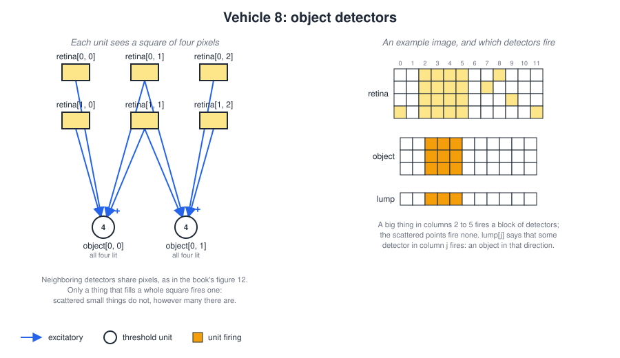
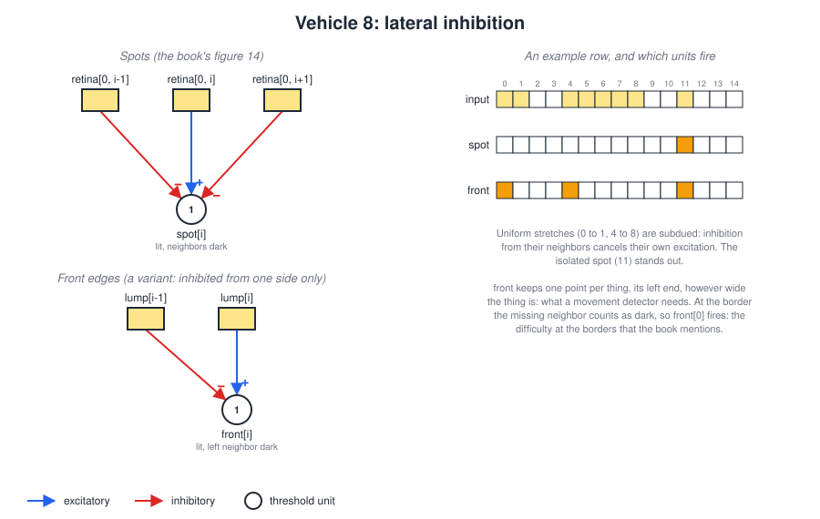
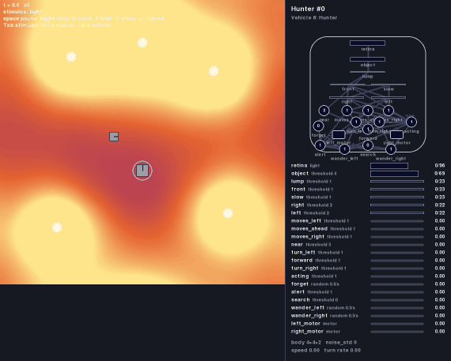

# Vehicle 8 — Space, things and movements: the hunter

## Summary

Braitenberg's Vehicle 8 gets an eye with a lens. The lens forms an image of the world on an array of photocells, so each photocell looks in its own direction. The camera of [camera.md](camera.md) is that eye: its pixels are the photocells.


*Vehicle 8 with a lens eye (Braitenberg, Vehicles, Figure 11).*

An image alone does nothing: it is just many sensors. The chapter shows how arrays of threshold devices behind the photocells turn it into something useful, with three circuits, each one device per position, all wired alike:

- **Object detectors** (the book's figure 12): a device that needs four neighboring photocells, in a square, all active at once. Scattered little things do not fire it, however many there are; a larger object does.
- **Movement detectors** (figure 13): a device that gets one photocell's signal through a delay and its neighbor's directly. It fires when something passes from the first to the second, and only in that direction.
- **Lateral inhibition** (figure 14): devices that inhibit their neighbors. Uniform light is subdued and isolated spots stand out.

The chapter also combines them: object detectors feeding movement detectors, so that only the movement of objects of a certain size counts, and neighboring movement detectors feeding an object detector, which sees an object only as points that move together.

This spec builds those circuits as units, with the same structure as the book's figures, and adds what they need to work in the simulator:

- **Arrays of units**, so that one item in the definition stands for one unit per position. The hunter below has about 190 units.
- **One point per object**, so that movement detectors do not fire for still objects (see *Why movement detectors need points*).

The example vehicle is the **hunter**. It sits still and watches a field of lamps. When something moves, and only then, it turns toward it and lunges. The lamps are as bright as its prey, so it can tell the prey apart only by its movement. Its pipeline is the book's combination: object detectors, reduced to one point each by lateral inhibition, feeding movement detectors.

## Arrays of units

### Declaring an array

A unit with an `array` key stands for one unit per index, all with the same type, threshold, delay and wiring:

```yaml
- unit:
    name: front
    type: threshold
    threshold: 1
    array: 23                  # front[0] ... front[22]; i is the index
    inputs:
      - input:
          from: lump[i]        # each front[i] gets lump[i] ...
      - input:
          from: lump[i-1]      # ... and is inhibited by its left neighbor
          type: inhibitory
      - input:
          from: acting         # an ordinary unit: every front[i] gets it
          type: inhibitory
```

| Key | Meaning |
|---|---|
| `array` | An integer `n` for a row of `n` units, `name[0]` to `name[n - 1]`, with index `i`; or `[rows, columns]` for a grid of units `name[r, c]`, with indices `i` (row) and `j` (column). Positive integers. |

The **elements** of an array are ordinary units. Each gets the item's `type`, `threshold`, `delay` and `inputs`, with `i` (and `j`) replaced by its own index. Each has its own delay line and simultaneity window, and each learning connection in it has its own strength ([vehicle-07.md](vehicle-07.md)).

### Indices in inputs

Inside an array's inputs, an index of a camera or of another array may be an **expression**: `i`, `i+k` or `i-k` for an integer `k` (and the same with `j`), or a constant. Ranges (`a:b`) and `:` take constants only, and may be mixed with expressions, as in `object[:, i]`.

- An input whose index falls **outside** its source, for some element, is **left out** for that element. `lump[i-1]` gives `front[0]` no inhibitory input. So at the border of the image a missing neighbor counts as dark; the book notes that lateral inhibition has difficulties at the borders, and this is that difficulty.
- A **constant** index out of range is an error, as for any pixel input ([camera.md](camera.md), *Pixel inputs*).

Outside arrays, units and motors refer to elements like pixels: `lump[3]`, `lump[0:12]` (twelve inputs, one per element), or `object[1, 0:4]`. Naming an array without an index is an error. An array may take inputs from elements of itself, as a unit may from itself.

An array of units is a shorthand. A definition with an array behaves exactly like the same definition with its elements written out one by one.

### In the diagram

[vehicle-diagram.md](vehicle-diagram.md) is updated to match:

- An array is drawn as a strip of small cells (a grid for a two-dimensional array), one per element, each lit by its element's output, like a camera ([camera.md](camera.md), *In the arena and the diagram*). The array's `position`, if any, places the middle of the strip.
- The wires between two parts with the same sign are drawn as one arrow, whatever elements they connect, labeled with the inputs as written (such as `lump[i-1]`). Wires of different signs between the same two parts are drawn side by side.
- The readouts show an array as one line with its strip of cells, instead of one line per element.

### Loading and validation

In addition to the cases in [vehicle-definition.md](vehicle-definition.md) and [camera.md](camera.md), loading fails, naming the file and the key, when:

- `array` is not a positive integer or a pair of positive integers;
- an index expression uses `i` or `j` outside an array, `j` in a one-dimensional array, or is not of the form `i`, `i+k`, `i-k`, `j`, `j+k`, `j-k`, an integer, `a:b` or `:`;
- an input indexes an array with the wrong number of indices, or names an array without an index;
- a constant index or range is outside its source.

## The circuits

The camera's `response` is a `step` with `height` 1, so each pixel outputs 1 where something bright fills enough of it (**lit**) and 0 where not.

### Object detectors



| Array | Inputs | Threshold | Fires when |
|---|---|---|---|
| `object[i, j]` (`rows - 1` × `columns - 1`) | `retina[i, j]`, `retina[i, j+1]`, `retina[i+1, j]`, `retina[i+1, j+1]` | 4 | all four pixels of the square are lit |

This is the book's figure 12. Each detector adds up four neighboring pixels arranged in a square, and needs all four. Little things, or things far away, light a pixel here and there, about as many in one part of the view as in another; they rarely light a whole square. A larger object, or a near one, fills squares, and the detectors behind them fire. The detector tells lumps of matter from scattered detail, which the book counts among the most useful things a vehicle can have.

This is why the camera is a matrix ([camera.md](camera.md)): a square needs two rows. With the camera's rows of a few degrees around the horizon, a thing fills two rows only when it is near enough, so an object detector also says that a thing is **near**.

Two more arrays turn the grid into a row that the other circuits can use:

| Array | Inputs | Threshold | Fires when |
|---|---|---|---|
| `lump[i]` (`columns - 1`) | `object[:, i]` | 1 | some object detector in column `i` fires: there is an object in that direction |

### Lateral inhibition



| Array | Inputs | Threshold | Fires when |
|---|---|---|---|
| `spot[i]` | `retina[0, i]`, inhibitory `retina[0, i-1]` and `retina[0, i+1]` | 1 | column `i` is lit and both neighbors are dark: an isolated spot |
| `front[i]` | `lump[i]`, inhibitory `lump[i-1]` | 1 | there is an object in column `i` and not in the one to its left: the object's **left end** |

`spot` is the book's figure 14. Each unit is excited by its own pixel and held back by its neighbors. Under uniform light the inhibition cancels the excitation everywhere, and only isolated spots stand out. Uniform regions carry little information, so losing them costs little.

In the book the threshold devices inhibit **each other**, more strongly the more active they are. In this project units are all-or-nothing, so a row of units inhibiting each other under uniform light would all switch on together, then all off, and so on. Taking the inhibition from the neighbors' **inputs** instead gives the same result without the flicker.

`front` is a variant, inhibited from one side only. It keeps exactly one point of each object, its left end, however wide the object is. That is what the movement detectors need.

### Movement detectors

![Movement detectors after the book's figure 13: each front point feeds a slow unit, and right[j] gets slow[j] and front[j+1]; timing charts show right[j] firing for a thing moving right and left[j] for one moving left](images/vehicle8-movement.svg)

| Array | Inputs | Threshold | Delay | Fires |
|---|---|---|---|---|
| `slow[i]` | `front[i]` | 1 | 0.3 | what `front[i]` did 0.3 s ago, held a little longer |
| `right[i]` (`n - 1`) | `slow[i]`, `front[i+1]` | 2 | 0.05 | a point was at `i` a moment ago and is at `i+1` now: **moving right** |
| `left[i]` (`n - 1`) | `slow[i+1]`, `front[i]` | 2 | 0.05 | a point was at `i+1` and is at `i` now: **moving left** |

This is the book's figure 13. The delay is a unit with a long delay; in Braitenberg's words, "A sluggish threshold device will do." When a point moves from `i` to `i+1`, `slow[i]` still carries its passage through `i` when it arrives at `i+1`, and `right[i]` gets both signals at once. A point moving the other way reaches `i+1` first, when `slow[i]` has nothing yet, and `slow[i]` fires only after the point has left `i+1`: the two signals never meet, so the detector is directional. (The book's text describes the left-to-right detector, and its figure the right-to-left one; they are mirror images, `right` and `left` here.)

With these delays and `dt` 0.01 a detector fires when the point takes more than about 0.15 s from one column to the next. A faster point has left `i+1` before `slow[i]` fires. There is no upper limit: `slow` holds its signal as long as the point stays in `i`, so a slow movement is seen too. The timing charts in the figure are computed with these units and the delays and simultaneity windows of [vehicle-definition.md](vehicle-definition.md).

#### Why movement detectors need points

The book's detector reads photocells directly, and talks of a spot moving by. A still thing two columns wide keeps both photocells lit, so both `right` and `left` would fire for as long as it is there, without any movement. Fed with `front` instead, every object is one point: a still object keeps one `front` lit and fires no detector, and a moving one moves its point. Feeding movement detectors with object detectors is the chapter's own suggestion, to make them respond only to objects of a certain size; lateral inhibition, also from the chapter, reduces each object to a point.

A lamp that switches on lights its point all at once, without coming from a neighbor, so it does not fire a detector either.

#### Combinations

The chapter suggests more combinations; they are not used by the hunter, but are made of the same parts:

- **Size-tuned movement:** the hunter's pipeline. Only things that fill object detectors take part, so the movement of small or distant things is ignored.
- **Objects made of movement:** a unit summing a few neighboring `right` detectors, with a threshold of 2 or 3, fires for several points moving the same way together. It sees an object only as points moving together, as we see a cuttlefish against the sand only when it moves.
- **Other directions and speeds:** the same circuit along the columns of a grid (`slow[i, j]` with `front[i+1, j]`) detects vertical movement, and a longer delay tunes it to slower movement.

## The hunter

The hunter is a predator that waits and watches, as a frog or a cat does. It stands still in a field of lamps, with its eye looking ahead. Somewhere in the field wanders its prey, which shines exactly as brightly as the lamps: in a single image the hunter cannot tell the prey from a lamp. What gives the prey away is that it moves.

As long as nothing moves, the hunter does nothing. When the prey moves in view, the hunter turns toward it, stops, and looks again. When the prey is straight ahead, it lunges forward, stops, and looks again. It goes on like this, in short bursts, until it is close to the prey. If the prey stops, it vanishes among the lamps, and the hunter waits for it to move again.

Its brain is the chapter's circuits in a row. Object detectors find the lumps in the image, and ignore little things and things far away. Lateral inhibition reduces each lump to one point. Movement detectors watch those points, and fire only for the ones that change column. Which part of the image the movement is in decides whether to turn left, turn right or lunge. One more unit blinds the hunter while it moves, since its own movement would make the lamps seem to move too.



*The default scenario with seed 3, first 20 seconds (played at twice the speed). In the panel, `lump` and `front` follow the objects in view; the commands fire in short bursts, each after `right` or `left` has seen the prey move. The hunter reaches the prey at 17 s.*

### The world

`worlds/still-lamps.yaml`: a 100 × 100 arena with `edges: wrap` and five lamps of `light`, at `[20, 20]`, `[80, 25]`, `[25, 80]`, `[75, 75]` and `[50, 85]`, each with `intensity` 10, `falloff` 15, `radius` 1.5 and `height` 3. Nothing in it moves.

### The prey

`vehicles/vehicle8-prey.yaml`: a vehicle with no sensors that wanders: `size` 3, `height` 2, `noise_std` 0.8, and two motors with `base_speed` 2 and no inputs. Its `appearance` is `light: 10`, as bright as a lamp, so in the hunter's eye it looks just like one until it moves.

### Design


#### Parts

- **Body:** `size` 4, `noise_std` 0. Without noise it stays perfectly still when nothing moves; with noise its own small turns would shift the image.
- **Camera:** `retina` at `[0, 0.88]`, `type: light`, `field_of_view` 180, `columns` 24 (7.5° each), `rows` 4, `vertical_field_of_view` 8 (2° each, two rows above the horizon and two below), `height` 1, `range` 30, `response: {type: step, at: 3}`. With the default 3 × 3 lines of sight per pixel, a pixel is lit when one of its three columns of lines of sight meets a thing. Every lamp and the prey stand on the ground and are taller than the camera, so they cross the horizon and light the two middle rows. A thing lights two neighboring columns, and so fills an object detector, when it is more than about 2.5° wide: the prey or a lamp anywhere within the camera's range of 30, but a thing of radius 0.2 only within about 9 units.
- **Motors:** `left_motor` at `[-0.5, -0.7]` and `right_motor` at `[0.5, -0.7]`, `base_speed` 0, `gain` 3, `max_speed` 6. With no input the hunter stands still. Each motor takes `forward` twice, so the hunter turns with one wheel at 3 and lunges with both at 6, three times as fast as the prey.

#### Units

The arrays of the circuits above: `object` (3 × 23), `lump`, `front` and `slow` (23 each), `right` and `left` (22 each). `front` has one more inhibitory input, from `acting` (see *Holding still to look*). Then:

| Unit | Inputs | Threshold | Delay | Fires when |
|---|---|---|---|---|
| `moves_left` | `right[0:8]`, `left[0:8]` | 1 | 0.05 | something moves on the left, more than about 25° from straight ahead |
| `moves_ahead` | `right[8:14]`, `left[8:14]` | 1 | 0.05 | something moves ahead, within about 25° |
| `moves_right` | `right[14:22]`, `left[14:22]` | 1 | 0.05 | something moves on the right |
| `near` | `lump[10:13]` | 3 | 0.05 | an object fills the middle columns: within about 10 units for a thing the size of the prey |
| `turn_left` | `moves_left`, inhibitory `moves_ahead` | 1 | 0.1 | movement on the left and not ahead |
| `turn_right` | `moves_right`, inhibitory `moves_ahead` | 1 | 0.1 | movement on the right and not ahead |
| `forward` | `moves_ahead`, inhibitory `near` | 1 | 0.3 | movement ahead, and not already near it |
| `acting` | `moves_left`, `moves_ahead`, `moves_right`, `turn_left`, `turn_right`, `forward` | 1 | 0.1 | from when the hunter starts moving until it has stopped |

The motors are wired crossed for turning: `right_motor` takes `turn_left` and `forward` (twice), `left_motor` takes `turn_right` and `forward` (twice).

A unit's output lasts its delay longer than its input, plus its simultaneity window, so a command lasts twice its delay longer than the movement that called for it. A detection typically gives a turn of about 35° (86° per second, for about 0.4 s), or a lunge of about 4 units (6 per second, for about 0.6 s). The turns are short so that the hunter does not swing past a prey that is only a little to one side; the zone ahead is wide for the same reason. The lunges are long and fast so that the hunter gains on a prey that never stops.

#### Holding still to look

When the hunter moves, the whole image slides across the eye, and every lamp's point moves from column to column, which is exactly what movement looks like to the detectors. Animals have the same problem with their own eye movements, and the same solution: they do not see during them.

The turns turned out to need little help: at 86° per second a point crosses a column in less than 0.1 s, too fast for the movement detectors (see *Movement detectors*), which do not see what they are not tuned to. The lunges are another matter. They shift nearby lamps slowly across the image, at a speed the detectors do see, and a hunter that kept watching would lunge again and again at lamps.

`acting` silences every `front`. It takes the same inputs as the turns and has the same delay, so it switches on at the moment the motors do, and goes off just after they stop. With `front` silent, `slow` empties too, so no trace of the image during the move is left. When `front` wakes up, every object's point appears at once, which is not movement, and only what moves after that is seen.

Measured over seeds 0 to 4, in 60 s each: without `acting`, the hunter gives commands for 8.5 s while its prey is behind it or out of range, reacting to its own movement; with `acting`, never. Being blind has a price, though: a hunter without `acting` keeps moving, and so finds its prey sooner (all 15 seeds from 0 to 14, against 14 of 15). The hunter here is the one that looks before it moves.

So the hunter moves in bursts: watch, turn or lunge, stop, watch again.

#### How it hunts

- **A still world:** no point moves, so no detector fires, and the hunter stands still. At the very start every point appears at once, which is not movement either.
- **The prey moves in view:** its point moves from column to column, the detectors in that part of the image fire, and the hunter turns toward that side. After the turn it holds still and looks again. When the prey is ahead, it lunges instead.
- **Reaching it:** once the prey fills the three middle `lump` columns, within about 10 units, `near` stops the lunges. The hunter keeps turning to follow it.
- **The prey stops:** it becomes as invisible as a lamp, and the hunter waits.
- **The prey is far:** beyond the camera's range of 30 the hunter does not see it at all. A prey that wanders off while the hunter waits is lost.
- **The prey is behind:** a camera of 180° sees nothing behind the hunter. A prey that goes around it is lost until it comes back into view.

The values were tuned on seeds 0 to 14: within 120 s the hunter comes within 8 units of its prey in 14 of the 15 (in 13 of them within 40 s). In the one that fails, the prey wanders out of range before the hunter reaches it. The first design (turns of 0.3 s delay and lunges at 3) reached the prey in only 10 of the 15: it swung past the prey on every turn, and fell behind a prey that never stops.

## Definitions, world and scenario

- `vehicles/vehicle8-hunter.yaml`: the hunter, `general.type` `"8"`.
- `vehicles/vehicle8-prey.yaml`: the prey.
- `worlds/still-lamps.yaml`: the world above.
- `scenarios/vehicle8-hunter.yaml`: one hunter at `[50, 40]`, heading 90° (up), and one prey at `[40, 52]`, heading 0° (moving right, across the hunter's view, about 16 units away), `dt` 0.01.
- `specs/images/vehicle8-objects.svg`, `vehicle8-lateral-inhibition.svg` and `vehicle8-movement.svg`: the circuit diagrams above, drawn by hand in the style of the generated diagrams; the timing charts are computed with the project's units.
- `specs/images/vehicle8-hunter.svg` and `specs/images/vehicle8-hunter.gif`: the hunter's diagram and the recording above.

```
python -m braitenberg scenarios/vehicle8-hunter.yaml
python -m braitenberg.diagram vehicles/vehicle8-hunter.yaml --out specs/images/vehicle8-hunter.svg
python -m braitenberg.record scenarios/vehicle8-hunter.yaml --seed 3 --seconds 20 --every 0.1 --speed 2 --scale 0.5 --out specs/images/vehicle8-hunter.gif
```

## Related specs

- [camera.md](camera.md): the eye. Its *Out of scope* pointed here for arrays of units.
- [vehicle-definition.md](vehicle-definition.md): the `array` key of a unit, index expressions, and their validation.
- [vehicle-diagram.md](vehicle-diagram.md): arrays as strips and grids, in the panel, the readouts and the SVG.
- [vehicle-05.md](vehicle-05.md): threshold units, delays and simultaneity, which every circuit here is made of.

## Acceptance criteria

Criteria 3 to 7 test the circuits on a **watcher**: the hunter's definition with the inputs of its motors removed, so it never moves, with `dt` 0.01. Where they set the outputs of a camera or an array by hand, the units downstream are run on those outputs. Things move past the watcher as prey vehicles with `noise_std` 0, driving straight at a constant speed.

1. **Arrays:** an array with `array: 23` creates units `name[0]` to `name[22]`, and `[3, 23]` creates `name[0, 0]` to `name[2, 22]`. Index expressions take each element's index; an input out of range for an element is left out for that element only. The hunter's definition and the same definition with every element written out by hand produce the same trajectory for the same seed.
2. **Validation:** each failure case under *Arrays of units*, *Loading and validation* raises an error naming the file and the key.
3. **Object detectors:** with the camera's outputs set to the image in the object detector figure, `object` and `lump` fire exactly where the figure shows.
4. **Lateral inhibition:** with the input row of the lateral inhibition figure, `spot` and `front` fire exactly where the figure shows.
5. **Direction:** with `front[j]` on for `T` seconds and then `front[j+1]` on for `T` seconds: `right[j]` fires for every `T` from 0.2 to 5 s, and never for `T` up to 0.1 s; `left[j]` never fires. In the other order, the same holds with `left[j]` and `right[j]` swapped.
6. **Why points:** with `right` and `left` fed from the pixels of one row instead of from `front`, a still thing two columns wide makes both fire; fed from `front`, neither fires.
7. **A thing crossing:** a prey crossing the watcher's view from left to right, 12 units ahead at speed 3, makes `right` fire in column after column from left to right, and `left` never. From right to left, the opposite. A prey with radius 0.2 crossing the same way fires no object detector and no movement detector. A lamp switched on by a schedule in view fires no movement detector. In a world where nothing moves, no movement detector ever fires.
8. **Still world:** the hunter in the default scenario with a prey whose motors have `base_speed` 0 does not move: after 60 s its position and heading are those it started with.
9. **Hunts:** in the default scenario, for each of seeds 0 to 4, within 120 s the hunter comes within 8 units of the prey (center to center) at least once.
10. **Holding still to look:** in the default scenario, over seeds 0 to 4, in 60 s each, the hunter gives no command while its prey is behind it (more than 90° from its heading) or out of range (more than 30 units away). With the inhibitory input from `acting` removed from `front`, it does, for at least 4 s in all.
11. **Diagram:** the diagram of the hunter reports each array as one part with one value and level per element, and draws it as a strip or grid. The SVG draws one arrow for the wires between two parts with the same sign, labeled with the inputs as written (such as `lump[i-1]`). Building it never imports pygame, and the renderer draws the hunter's window without errors.
12. **Headless and fast:** the default scenario runs 60 simulated seconds headless in under 15 seconds. (It takes about 1.5 s.)

## Out of scope

- **Learning space.** The circuits here are wired by the designer: which pixels are neighbors is written in the definition. A vehicle that discovers its own neighbor relations, by noticing which pixels tend to light up together, would use Mnemotrix wires ([vehicle-07.md](vehicle-07.md)) between pixels; it is left for later.
- **Graded lateral inhibition**, where a more active unit inhibits its neighbors more. Units are all-or-nothing.
- **Shapes.** Telling things apart by their outline is Braitenberg's Vehicle 9.
- **Movement while moving.** The hunter only sees movement while it stands still. Telling the prey's movement from its own, by subtracting what its own movement should do to the image, is not attempted.
- **Two eyes and depth by disparity.** Each vehicle here has one camera.
- Arrays of sensors or motors, arrays with more than two indices, and index expressions other than `i ± k` and `j ± k` (such as `2*i`).
