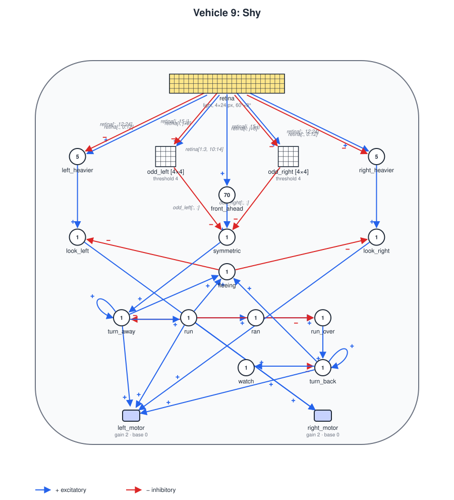

# Vehicle 9: Shapes

## Summary

Braitenberg's Vehicle 9 ("Shapes") recognizes things by their **shape**. Vehicle 8 sees where things are and whether they move; Vehicle 9 tells what they are from their outline. The chapter's main problem is that the same shape falls on very different places of the eye, at different sizes and angles, and it offers several ways of recognizing it all the same. One of them is **symmetry**: if the two halves of the eye are wired as mirror images of each other, comparing the left with the right tells a symmetric thing from an asymmetric one.

Symmetry matters to an animal for a simple reason: an animal is bilateral, and it looks symmetric from one place only, when it faces you, coming at you. Seen from the side, from behind or at an angle, it does not, or not with its face in the middle. A symmetric animal with its face in the middle of your view is coming at you.

This spec implements that. Vehicles are boxes whose faces have colors ([camera.md](camera.md), *Vehicles as things*): a vehicle with a white front and gray sides and back looks symmetric, with white in the middle, only when it comes straight at you. The **shy vehicle** watches what it sees, and runs from whatever comes straight at it: it turns away, runs, and turns back to watch again. A **chaser** follows it, and two **walkers** wander by; the shy vehicle runs from the chaser, which keeps coming at it, and from a walker only when the walker happens to come straight at it.

It needs one addition to the definitions: index expressions of the form `k - i`, so that a unit can take a pixel and its mirror image.

## Mirror images

An index expression in the inputs of an array ([vehicle-08.md](vehicle-08.md), *Arrays of units*) may now also be `k - i` or `k - j`, with `k` a whole number: the element with index `i` takes index `k - i`. As with `i + k`, an index that falls outside the sensor or array leaves that input out for that element only.

With a camera of 24 columns, `retina[i, 23-j]` is the mirror image of `retina[i, j]` about the middle of the view. A unit that takes `retina[i, j]` excitatory and `retina[i, 23-j]` inhibitory compares a pixel with its mirror image.

## The detector

The shy vehicle's eye is a camera of 24 columns, 2.5° each, across 60°, and 4 rows of 2°, two above the horizon and two below. It has no response: each pixel reports the brightness it sees, 10 for a white front, 5 for a gray face, 0 for the ground or the sky, or a mixture where a thing covers part of the pixel.

- **Mismatches:** `odd_left[i, j]`, for the 8 middle columns, takes column `8 + j` excitatory and its mirror image, column `15 - j`, inhibitory, with threshold 4: it fires when the pixel on the left is brighter than its mirror image by 4 or more. `odd_right` is the same the other way around. A white front against the ground, or a gray face against the ground, differ by 10 or 5, and fire them; the edges of a thing that covers a pixel and its mirror image by different amounts differ by less, and do not.
- **A white front in the middle:** `front_ahead` takes the 4 middle columns, on both sides of the horizon, with threshold 70: those 8 pixels are mostly white.
- **Symmetric:** `symmetric` fires on `front_ahead`, inhibited by every mismatch.

Only the 8 middle columns, 20°, are compared, so that other things in view, to the sides, do not break the symmetry of the one in the middle. The vehicle turns to keep what it watches in the middle (see *Watching*).

So `symmetric` fires for a vehicle coming straight at it, within about 5° at most distances and up to 20° from close by, and not for one seen from the side or from behind (no white in the middle), nor at 45° or more (white and gray, or white and ground, side by side). Measured with a still vehicle 6 to 25 units ahead, turned by an angle from facing the shy vehicle:

| Distance | 0° | 5° | 10° | 15° | 20° | 30° | 45° and more |
|---|---|---|---|---|---|---|---|
| 6 | yes | yes | yes | yes | yes | yes | no |
| 10 | yes | yes | yes | yes | yes | no | no |
| 15, 20 | yes | yes | no | no | no | no | no |
| 25 | yes | yes | yes | no | no | no | no |

The tolerance depends on the distance because pixels are 2.5° wide: how much of the side shows, and in which pixels, changes with the size of the image.

## The shy vehicle

### The world

`worlds/open-field.yaml`: a 100 × 100 arena with `edges: wrap`, and two stimuli with no sources, `light` and `blue`. Nothing shines: what cameras see are vehicles, by the colors of their faces.

### The walker

`vehicles/vehicle9-walker.yaml`: `size` 4, `height` 2, `noise_std` 0.8, two motors with `base_speed` 2 and no inputs. Its `appearance` is `light: {front: 10}`, a white front and gray (5) everywhere else, and `blue: 0`, so that the chaser does not see it.

### The chaser

`vehicles/vehicle9-chaser.yaml`: like the walker, with `noise_std` 0.3, and a camera that sees `blue`: 18 columns of 5° across 90°, one row of 10°, `range` 60, `response: {type: step, at: 1}`. Only the shy vehicle is blue (10); the others are black for this camera (`blue: 0`), so it sees the shy vehicle alone, even far away, where it covers a fraction of a pixel. The motors are crossed, with `base_speed` 1.5, `gain` 1 and `max_speed` 3: `left_motor` takes the 9 right columns and `right_motor` the 9 left ones, so it turns toward the side where more of the shy vehicle is, and goes straight at it when it is in the middle, at 3, half as fast as the shy vehicle runs. Its noise makes it weave a little, so that it comes straight at the shy vehicle now and then, not all the time.

### Design



#### Parts

- **Body:** `size` 4, `height` 2, `noise_std` 0. Its `appearance` is `blue: 10`, for the chaser.
- **Camera:** `retina` at `[0, 0.88]`, `type: light`, `field_of_view` 60, `columns` 24, `rows` 4, `vertical_field_of_view` 8, `height` 1, `range` 30, no response.
- **Motors:** `left_motor` at `[-0.5, -0.85]` and `right_motor` at `[0.5, -0.85]`, `base_speed` 0, `gain` 2, `max_speed` 6. With no input it stands still.

#### Units

The detector's arrays and units, `odd_left` and `odd_right` (4 × 4), `front_ahead` and `symmetric`, as above. Then:

| Unit | Inputs | Threshold | Delay | Fires when |
|---|---|---|---|---|
| `left_heavier` | `retina[:, 0:12]`, inhibitory `retina[:, 12:24]` | 5 | 0.05 | the left half of the view is brighter |
| `right_heavier` | the other way around | 5 | 0.05 | the right half is brighter |
| `look_left`, `look_right` | `left_heavier` or `right_heavier`, inhibitory `fleeing` | 1 | 0.05 | it turns toward the brighter half, unless it is fleeing |
| `turn_away` | `symmetric`, itself, inhibitory `run` | 1 | 0.05 | from when it is faced until `run` starts |
| `run` | `turn_away` | 1 | 1 | from a second after `turn_away` comes on, for about 2 s |
| `ran` | `run` | 1 | 0.5 | `run`, half a second late |
| `run_over` | `ran`, inhibitory `run` | 1 | 0.05 | `run` has just gone off |
| `turn_back` | `run_over`, itself, inhibitory `watch` | 1 | 0.05 | from when `run` is over until `watch` comes on |
| `watch` | `turn_back` | 1 | 1 | from a second after `turn_back` comes on |
| `fleeing` | `turn_away`, `run`, `turn_back` | 1 | 0.05 | any step of fleeing |

The motors: `left_motor` takes `look_right`, `turn_away` and `turn_back` three times each, and `run` three times; `right_motor` takes `look_left`, and `run` three times. So it watches by turning on one wheel at 2, turns away and back on one wheel at 6, and runs on both at 6.

#### Watching

`left_heavier` and `right_heavier` compare the brightness of the two halves of the view, and the vehicle turns toward the brighter one, at about 57° per second, until they are within 5 of each other: what it sees comes to the middle, and stays within about 9° of it. A still vehicle 20° to the side, 15 units away, is in the middle within half a second. Then the shy vehicle stands still, watching, and keeps it there as it moves.

#### Fleeing

A unit holding itself on, until a later unit that it feeds turns it off, makes a step that lasts that unit's delay: `turn_away` stays on until `run` comes on, a second later. Fleeing is three such steps:

1. **Turn away:** when `symmetric` fires, `turn_away` turns the vehicle on one wheel at 6, for about a second: a half turn, about 170°.
2. **Run:** `run` drives both wheels at 6 for about 2 s, about 11 units away.
3. **Turn back:** when `run` goes off, `run_over` fires for half a second, and `turn_back` turns it on one wheel again, for about a second, until `watch` stops it: it faces where it came from, and watches again.

While it flees it does not watch: `fleeing` holds `look_left` and `look_right` back. A vehicle that is still coming at it when it turns back is seen, symmetric, and the vehicle flees again.

### How it behaves

- **Something seen from the side, from behind, or at an angle:** the shy vehicle turns to watch it, and stays.
- **Something coming straight at it:** it flees, and turns back to watch. Against the chaser, which comes at it again and again, it keeps its distance: flee, turn back, flee, about every 5 s.
- **Close by, things look symmetric at wider angles**, up to 20°, and a vehicle that reaches it fills its view: it flees from what is on top of it too.
- **Nothing in view:** it stands still. It does not search: a chaser that comes at it from behind is not seen until it is in view.
- **A chaser that weaves** is seen symmetric only when it happens to come straight at it, which it does more often the closer it gets: the shy vehicle often flees at 12 to 15 units, not at the 25 it could.

Measured over seeds 0 to 9, in 60 s each, in the default scenario: it flees 123 times, and in 122 of those another vehicle was heading at it, within 25°, less than 32 units away. Against the chaser it settles into a rhythm: the chaser weaves toward it, comes straight at it at 12 to 15 units, the shy vehicle flees to about 16 and turns back, and so on. The chaser touches it (comes within 4.5 units, center to center) twice, and is within 6 units for 14 s in all; the same vehicle without fleeing (`turn_away` without its input from `symmetric`) is touched 10 times, and has the chaser within 6 units for 62 s.

## Definitions, world and scenario

- `vehicles/vehicle9-shy.yaml`: the shy vehicle, `general.type` `"9"`.
- `vehicles/vehicle9-chaser.yaml` and `vehicles/vehicle9-walker.yaml`: the chaser and the walkers.
- `worlds/open-field.yaml`: the world above.
- `scenarios/vehicle9-shy.yaml`: the shy vehicle at `[50, 30]`, heading 90° (up); the chaser at `[50, 60]`, heading 270° (down), straight at it; walkers at `[20, 45]`, heading 0°, and at `[80, 20]`, heading 180°; `dt` 0.01.
- `specs/images/vehicle9-shy.svg` and `specs/images/vehicle9-shy.gif`: the diagram and a recording of the default scenario.

```
python -m braitenberg scenarios/vehicle9-shy.yaml
python -m braitenberg.diagram vehicles/vehicle9-shy.yaml --out specs/images/vehicle9-shy.svg
python -m braitenberg.record scenarios/vehicle9-shy.yaml --seconds 30 --every 0.1 --speed 2 --scale 0.5 --out specs/images/vehicle9-shy.gif
```

## Related specs

- [camera.md](camera.md): the eye, and vehicles as boxes with colored faces.
- [vehicle-08.md](vehicle-08.md): arrays of units and index expressions, which `k - i` extends.
- [vehicle-definition.md](vehicle-definition.md): threshold units, delays and simultaneity.

## Acceptance criteria

Criteria 2 to 5 use the shy vehicle at `[50, 30]` heading 90°, and **still walkers**: walkers with `base_speed` 0 and `noise_std` 0. Criteria 2 and 3 disconnect the shy vehicle's motors, so that it does not move.

1. **Mirror images:** an array element `j` with input `retina[i, 15-j]` takes column `15 - j`; an index `k - i` outside the camera or array leaves that input out for that element only; `k - i` outside an array, or `k - j` in a one-dimensional array, is an error naming the file and the key.
2. **Symmetry:** with a still walker straight ahead, 10, 15 or 20 units away, `symmetric` fires when the walker faces the shy vehicle (heading 270°) or is turned 5° from it either way, and does not when it is seen from behind (90°), from either side (0° and 180°), or turned 45° or 60° either way.
3. **The middle only:** with a still walker facing it 15 units ahead and another one 25° to the side, seen side-on, `symmetric` still fires.
4. **Watching:** a still walker seen side-on, 15 units away and 20° to the left, is within 10° of the shy vehicle's heading after 1 s, and stays within 10° for the next 3 s; the shy vehicle does not flee.
5. **Fleeing:** with a still walker facing it 15 units ahead, the shy vehicle turns 150° to 190° in the first 1.5 s, then runs, ending 8 to 15 units farther from the walker, then turns back, and 4.5 s after it started fleeing it faces within 30° of where it faced at first.
6. **The scenario:** over seeds 0 to 9, in 60 s each, at least 90% of the times it starts fleeing another vehicle is heading at it (within 25°, less than 32 units away); and the chaser touches it (comes within 4.5 units) less than half as often, and is within 6 units of it for less than half as long, as with the same vehicle without fleeing.
7. **Diagram:** the diagram reports `odd_left` and `odd_right` as 4 × 4 arrays, and the SVG labels the wires from the camera with the inputs as written, `retina[i, j+8]` (excitatory into `odd_left`) and `retina[i, 15-j]` (inhibitory).
8. **Headless and fast:** the default scenario runs 60 simulated seconds headless in under 10 seconds. (It takes about 2 s.)

## Out of scope

- **Other shapes:** telling a box from a cylinder, a tall thing from a short one, or one outline from another. Symmetry is the one shape this vehicle sees.
- **Invariance by other means:** detectors repeated across the whole view, or normalizing size. The shy vehicle gets position invariance by turning to bring things to the middle, which works for one thing at a time.
- **Symmetry about other axes**, such as up and down, and periodic patterns.
- **Searching:** the shy vehicle does not look around when nothing is in view; the modules `boredom` and `wander` ([modules.md](modules.md)) could make it.
- **Fleeing as a module:** the three steps of fleeing are written in the vehicle; a module that turns a vehicle around, or runs, is left for when another vehicle needs it.
