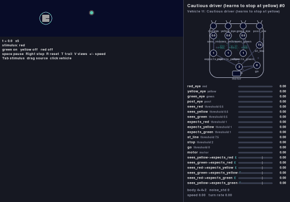

# Vehicle 11 — Rules and regularities: the cautious driver

**Status:** implemented. The cautious driver's values were checked from ten starting positions; see *Acceptance criteria*.

## Summary

Braitenberg's chapter on Vehicle 11 ("Rules and Regularities") adds a second kind of learning wire, the **Ergotrix**. The Mnemotrix wire of Vehicle 7 ([vehicle-07.md](vehicle-07.md)) learns what happens **together**. The Ergotrix wire learns what happens **in sequence**: it gets stronger when its source fires and its destination fires **shortly after**. Once it is strong, the source makes the destination fire at once, before the event that used to fire it arrives. The vehicle has picked up a regularity of its world, "B follows A", and acts on it: it **anticipates**.

The wire is asymmetric. A wire from A to B learns that A comes before B; it learns nothing when B comes before A, and nothing when they come together.

This spec adds the Ergotrix learning type to the vehicle definition and uses it in one example, the **cautious driver**. It is the Vehicle 5 driver ([vehicle-05-driver.md](vehicle-05-driver.md)) on the same looping road, but the traffic light now has a **yellow** phase between green and red. At first the driver knows only red: yellow means nothing to it, so it drives on, and when the light turns red at the wrong moment it either stops past the line or, already too close to see the light, runs the red. But in this world red always comes a few seconds after yellow, so an Ergotrix wire from *sees yellow* to *expects red* grows. In the same way it learns that yellow follows green and green follows red: the whole sequence of the light. After a few cycles, yellow alone makes the driver expect red, and it stops at the line as soon as the light turns yellow, as a careful human driver does. It has learned a traffic rule from the regularity of the light, with no one teaching it and no fine: red itself, coming after yellow, is the lesson. When the light is changed so that yellow is followed by green, each yellow without red weakens the wire, and the driver drives through yellow again. Wires that start alike from every color to every other mature only where the light's order says so: from green to yellow, but not from yellow to green.

A Mnemotrix wire cannot learn this. Yellow goes off when red comes on, so the two are never on together, and its rule never gets going.



*The default scenario, first 90 seconds (played at eight times the speed). The three forward wires, at the bottom of the panel, pass 0.7 in the first cycles; from then on the driver stops at the line when the light turns yellow, and the backward wires stay at 0.*

## Ergotrix connections

### The rule

An Ergotrix connection is a learning connection ([vehicle-definition.md](vehicle-definition.md), *Learning connections*) with `type: ergotrix`. As for Mnemotrix, its strength is a gate: the connection carries its source's full signal while its strength is above `0.7`, and nothing at or below it.

```yaml
- unit:
    name: expects_red
    type: threshold
    threshold: 1
    inputs:
      - input:
          from: sees_red         # fixed: red in sight is red expected
      - input:
          from: sees_yellow
          strength: 0            # starts inactive
          learning:
            type: ergotrix
            within: 5.5          # seconds after the source turns on in which the destination is expected
            learn: 0.3           # strength gained each time it comes in time
            forget: 0.1          # strength lost each time it does not
```

The rule works on **onsets**, the moments when something turns on, because a sequence is a matter of what starts first. For a connection from a source `S` to a unit `D`:

- **The source turns on** when `S`'s output is 1 this step and was 0 the step before.
- **The destination is driven by its fixed inputs** when the sum of `D`'s active inputs that do not learn, computed as for its activation, reaches `D`'s threshold. This leaves out this connection and every other learning connection into `D`. **It turns on** when it is true this step and was false the step before.

Each connection is either **waiting** or not; it starts not waiting. Each step:

| Event | What happens |
|---|---|
| Not waiting, and the source turns on | Start waiting, for `within` seconds. |
| Waiting, and the destination's fixed inputs turn on | `strength += learn`, stop waiting (it came in time: **learn**). |
| Waiting, and `within` seconds have passed since the source turned on | `strength -= forget`, stop waiting (it did not come: **forget**). |
| Otherwise | Nothing. |

The strength is clipped to `[0, 1]`. `within` is rounded to a whole number of steps, at least one; the wait covers the steps after the source turns on up to and including that many, and on its last step the destination turning on counts, before the wait expires. The source turning on again while the connection is waiting changes nothing: one wait is one prediction, judged once. If the destination is already driven when the source turns on, it must stop and turn on again within the wait to count: the source did not come before it, so it does not predict it.

**Why onsets.** Mnemotrix asks whether two things are on at the same time, which is a state. A sequence is an order of events: A starts, then B starts. Judging onsets also keeps the two wires apart. When `S` and `D` are on together for a long time, a Mnemotrix wire keeps growing; an Ergotrix wire learns once, and only if `S` started first.

**Why per event and not per second.** Mnemotrix gains `learn` per second because it learns from how long two things stay together. What an Ergotrix wire learns from is how often one thing follows another, so each pairing counts once, however long either lasts. So `learn` and `forget` are amounts of strength, not rates: with `learn` 0.3 a wire starting at 0 becomes active after three pairings.

**Why fixed inputs only.** Once active, the wire makes `D` fire whenever `S` turns on. If that counted, every prediction would come true by itself and could never be unlearned; Mnemotrix leaves out its own contribution for the same reason. An Ergotrix wire goes one step further and leaves out every learning input into `D`, because expectations chain: if A is learned to come before B, and B before C, then when A turns on, C is expected through B one step later, and a wire from A to C would learn from that expectation, though C itself comes long after A. The wire learns only from what `D`'s fixed causes, usually the senses, say about it: whether `D` itself came after `S`.

**Why nothing changes while the source is silent.** As with Mnemotrix, a rule is not forgotten just because it was not put to the test. It is weakened only when the source turns on and the destination does not follow: a prediction that failed. And `D`'s fixed inputs turning on with no `S` before them changes nothing either: the wire predicts `D` from `S`, it does not claim that `S` is the only way to `D`.

### Keys

The keys of a `learning` section, for both types:

| Key | Required | Meaning |
|---|---|---|
| `type` | yes | `mnemotrix` or `ergotrix`. |
| `learn` | yes | Mnemotrix: strength gained per second while source and destination are together. Ergotrix: strength gained each time the destination's fixed inputs turn on within `within` seconds after the source turns on. Not negative. |
| `forget` | no | Mnemotrix: strength lost per second while the source fires alone. Ergotrix: strength lost each time `within` seconds pass after the source turns on without them. Not negative. Default 0. |
| `within` | Ergotrix only, required | Seconds after the source turns on in which the destination is expected. Positive. |

The restrictions of learning connections hold for Ergotrix too: the source and the destination must be units, a unit may not learn from itself, and the connection may be excitatory or inhibitory with the same rule. An inhibitory Ergotrix wire learns that "after the source, the destination should be off", as long as the destination's fixed inputs keep turning it on at those times.

### Signal flow

The **learning** part of step 2 in [vehicle-definition.md](vehicle-definition.md), *Signal flow*, now updates both kinds of connection, from the same values. An Ergotrix connection uses its source's **output** this step (not its contribution in the destination's window: an onset is a moment, not a window) and whether the destination is driven by its fixed inputs, summed as for the activations. It keeps three things from step to step: its source's output and the destination's driven state at the previous step, and how many steps are left in its wait. At the first step both previous values are 0, so a source that is on from the start turns on at the first step. As for Mnemotrix, the new strength takes effect from the next step.

### Strength at run time, loading and validation

Everything in [vehicle-07.md](vehicle-07.md), *Strength at run time*, holds for Ergotrix connections: each vehicle starts with the definition's strengths and learns on its own, learning never writes the definition file, and restarting a scenario starts over, waits included.

In addition to the cases already listed, loading fails, naming the file and the key, when:

- an `ergotrix` section has no `within`, or a `within` that is not a positive number;
- a `mnemotrix` section has a `within` (it is not a key of that type).


## The cautious driver

### The world

`worlds/traffic-light-yellow.yaml`: the road of `traffic-light` ([vehicle-05-driver.md](vehicle-05-driver.md), *World*), 100 units long and 20 wide with `edges: wrap`, and a traffic light at `[50, 13]` with three phases. Every source is at the light:

| Stimulus | Intensity | Falloff | Schedule |
|---|---|---|---|
| `green` | 10 | 15 | `{period: 13.5, on_at: 0, off_at: 4.5}`: green for 4.5 s |
| `yellow` | 10 | 15 | `{period: 13.5, on_at: 4.5, off_at: 9}`: then yellow for 4.5 s |
| `red` | 10 | 15 | `{period: 13.5, on_at: 9, off_at: 13.5}`: then red for 4.5 s |
| `post` | 10 | 15 | none: always there |

Exactly one color is on at any time. The `post` is the traffic light itself, lit or not: it tells the driver where the stopping line is, whatever the color. The renderer draws `yellow` in its color, as it does `red` and `green`.

**Why the three phases are equally long.** Every wire has the same `within`. For the wire from one color to the next to learn, `within` must be at least as long as a phase: when the light turns green, yellow comes a whole green phase later. For the wire from a color to the one after next not to learn, `within` must be shorter than two phases. With phases of 4.5 s and `within` 5.5 both hold. A real light, with a short yellow between long green and red, would not allow it: red comes so soon after green that green would predict red too.

A 13.5-second cycle against a lap of about 20 seconds makes the driver's arrivals drift through every phase, so it meets each color at every distance. The cycle and the starting position are among the values to tune.

### Design

#### Parts

- **Body:** `size` 4, `noise_std` 0, as the Vehicle 5 driver.
- **Sensors:** `red_eye`, `yellow_eye`, `green_eye` and `post_eye`, side by side at the front at `x` = -0.85, -0.3, 0.25 and 0.85, `y` 0.9, reading `red`, `yellow`, `green` and `post`. Only `post_eye` has a `field_of_view`, 90, as the Vehicle 5 driver's eyes: it sees the light while it is ahead and not once the driver has passed it, or is within about 3 units of it. The three color eyes see all around, so the driver sees every change of the light wherever it is on the road (see *Seeing every change*).
- **Motor:** a single `motor`, `base_speed` 0, `gain` 5, `max_speed` 5: it runs at 5 while it gets a signal and stops dead without one.

#### Units

The units come in two layers: what the driver **sees**, and what it **expects**.

| Unit | Inputs | Threshold | Fires when | Role |
|---|---|---|---|---|
| `sees_red`, `sees_yellow`, `sees_green` | that color's eye | 0.5 | the light shows that color (the reading is at least 0.8 anywhere on the road) | What the light shows |
| `expects_red`, `expects_yellow`, `expects_green` | `sees_` that color; and an **Ergotrix** wire from each of the other two `sees_` units (strength 0, `within` 5.5, `learn` 0.3, `forget` 0.1) | 1 | the light shows that color, or the color that, once learned, comes before it | What the light shows or is about to show |
| `at_line` | `post_eye` | 7.5 | the light is ahead and about 8.3 units away or closer | The stopping line |
| `stop` | `expects_red`, `at_line` | 2 | red expected AND at the line | Time to stop |
| `go` | inhibitory `stop`, `sees_green` | 0 | always, unless `stop` is on and `sees_green` is off | Drive |

The motor's only input is `go`.

The Vehicle 5 driver's `red_close` (red reads 8 or more) is split: *what* the light says, seen from anywhere on the road, and *where* to act on it, `at_line`, read from the post. With every wire inactive the cautious driver stops exactly where the Vehicle 5 driver does, two unit delays later. The split is what lets the wires be useful: what the driver learns is a meaning, such as "yellow means red is coming", and it learns it from every change of the light, wherever the driver is, not only from the few it happens to see while it waits at the line.

**Seeing every change.** A color unit turns on when the light changes to that color, but with eyes that only look ahead it would also turn on when the light comes into view, already showing that color for a while. To the wires that looks like a change, and a wrong one: a red that comes into view in its last second is followed by green within a second and by yellow 5.5 s later, so `sees_red → expects_yellow` would pair. With the driver's laps locking to the light's cycle, that happens on lap after lap, and backward wires mature. Color eyes that see all around, with a threshold low enough to read the light from anywhere on the road, turn the color units on only when the light really changes. Where to stop still comes from the post, which is seen only ahead.

**Why two layers.** Wires go from what is seen to what is expected, never from one expectation to another. If the wires ran between the seen units themselves, then once the whole cycle was learned, green would fire yellow, yellow red, and red green again: a loop that, once started, would run forever, with every color "seen" at once, and the driver stopping at green. Expectations that set off further expectations are Braitenberg's next step, Vehicle 12, "Trains of Thought". Here each expectation comes only from what the driver sees.

#### Six wires, three mature

Each expected color has a wire from the two other seen colors, six Ergotrix wires that start alike. Experience matures the three that follow the light's order and leaves the three that go against it:

| Wire | What it would predict | Matures? |
|---|---|---|
| `sees_green → expects_yellow` | yellow comes after green | **yes**: 4.5 s after green turns on |
| `sees_yellow → expects_red` | red comes after yellow | **yes**: 4.5 s after yellow turns on |
| `sees_red → expects_green` | green comes after red | **yes**: 4.5 s after red turns on |
| `sees_yellow → expects_green` | green comes after yellow | no: 9 s after yellow turns on, red comes in between |
| `sees_red → expects_yellow` | yellow comes after red | no: 9 s after red turns on |
| `sees_green → expects_red` | red comes after green | no: 9 s after green turns on |

For each pair of colors, one direction matures and the other does not: the wires learn an **order**, not an association. Only `sees_yellow → expects_red` changes how the driver drives, since only expecting red makes it stop. The other two mature wires show that it knows the rest of the sequence, which the panel shows as `expects_` units lighting up one phase ahead.

#### How it learns

- **Before learning** yellow means nothing: the driver drives through it. When the light turns red with the driver past the line but still more than about 3 units away, it stops where it is, past the line. Closer than that, it no longer sees the light and runs the red.
- **Every change teaches.** The light turns yellow, and `sees_yellow → expects_red` starts waiting. 4.5 s later the light turns red, `sees_red` turns on while the wire waits: `+0.3`. Green and red teach their wires the same way. The driver sees every change wherever it is, so the three forward wires gain once per cycle, and are active after three cycles, about 40 s.
- **Once learned**, `expects_red` fires as soon as the light turns yellow. Far from the light, nothing happens: the driver expects red but is not at the line, and drives on. At the line, `stop` fires, and the driver waits there through the rest of yellow and the red, and goes on at green. If yellow comes on when it is already past the line, it stops where it is; within 3 units of the light it no longer sees the post, and passes on yellow.
- **Each stop confirms the rule.** Stopping at the line does not prevent the red: it comes, `sees_red` turns on, and the wire gains again. Unlike Vehicle 7's wary moth, whose avoidance keeps it from the burns that confirm its wire, so that it keeps forgetting and checking, the driver's anticipation is confirmed every time: it does not forget while the world stays the same.
- **It never runs a red.** For the light to turn red while the driver is within 3 units of it, it must have turned yellow when the driver was 22.5 units further back, with the post in sight, and the driver stopped at the line.
- **The three backward wires do not grow.** When the light changes color, the color after next comes 9 s later, longer than `within`, so the wire loses 0.1 and stays at 0. Nor do they learn through the forward wires: once green is expected right after red, `expects_green` fires one phase early, but only fixed inputs teach, so `sees_yellow → expects_green` does not take that for green itself.
- **Unlearning.** If the light's order is reversed, every forward wire is wrong each time and falls to 0.7 or below, while the backward wires now pair and grow: the immature wires were waiting for a world in which they are true. With the order green, red, yellow, the driver no longer stops at yellow, since red does not follow it.

Nobody penalizes running a red. The criteria count it to show that the driver drives better after learning, but nothing in the driver or the world reacts to it: the rules are learned only from the order in which the light changes.

#### Diagram and panel

Ergotrix wires are drawn like Mnemotrix wires ([vehicle-diagram.md](vehicle-diagram.md)), with their own color, a teal green (`#0d9488`), kin to the Mnemotrix green but told apart from it, and the label `E`: wider as they grow stronger, dashed while inactive. Their readout line reads, for example, `sees_yellow->expects_red  E  0.30`, and the panel also shows whether the wire is waiting. The legend of the SVG explains `E` when the vehicle has an Ergotrix wire. Once the wires are active, watch each `expects_` unit turn on one phase before its color: `expects_red` as soon as the light turns yellow, while the driver is still far from the light.

## Definition, world and scenario

- `vehicles/vehicle11-cautious-driver.yaml`: the definition above, `general.type` `"11"`, named *Cautious driver (learns to stop at yellow)*.
- `worlds/traffic-light-yellow.yaml`: the world above.
- `scenarios/vehicle11-cautious-driver.yaml`: one cautious driver on `traffic-light-yellow` at `[25, 10]`, heading 0, `dt` 0.01.
- `specs/images/vehicle11-cautious-driver.svg` and `specs/images/vehicle11-cautious-driver.gif`: the diagram and a recording of the first 90 seconds.

```
python -m braitenberg scenarios/vehicle11-cautious-driver.yaml
python -m braitenberg.diagram vehicles/vehicle11-cautious-driver.yaml --out specs/images/vehicle11-cautious-driver.svg
python -m braitenberg.record scenarios/vehicle11-cautious-driver.yaml --seconds 90 --every 0.25 --speed 8 --scale 0.5 --out specs/images/vehicle11-cautious-driver.gif
```

## Related specs

- [vehicle-07.md](vehicle-07.md): the Mnemotrix wire, learning connections and their rules at run time.
- [vehicle-05-driver.md](vehicle-05-driver.md): the driver, the road and the traffic light this example builds on.
- [vehicle-definition.md](vehicle-definition.md): the `ergotrix` type and `within` key under *Learning connections*, and the validation cases.
- [vehicle-diagram.md](vehicle-diagram.md): Ergotrix wires and readouts, in the panel and the SVG.
- [worlds.md](worlds.md): schedules, used for the three phases of the light.

## Acceptance criteria

The driver has no noise, so where it meets the light depends only on where it starts. Criteria 1 to 5 run the default scenario headless for 300 seconds from each of the starting positions `x` = 0, 10, …, 90 (`y` 10, heading 0). The driver **runs a red** when its center passes the light's `x` while `red` is on. A **control** is the same definition with `learn` 0 on every wire.

1. **Learns the sequence:** from each starting position, the strengths of the three forward wires (`sees_green → expects_yellow`, `sees_yellow → expects_red`, `sees_red → expects_green`) all exceed 0.7 before 60 s.
2. **Stops at yellow:** from each starting position, after the strength of `sees_yellow → expects_red` first exceeds 0.7, there is a time when the driver comes to a stop while `yellow` is on, with its center between 7 and 9.5 units before the light, and it stays stopped until `green` comes on. It never stops while `green` is on.
3. **Only the forward wires mature:** from each starting position, the strengths of the three backward wires (`sees_yellow → expects_green`, `sees_red → expects_yellow`, `sees_green → expects_red`) stay 0 throughout.
4. **Never runs a red once learned:** from no starting position does the driver run a red after the strength of `sees_yellow → expects_red` first exceeds 0.7, and from at least one starting position the control runs a red in the same 300 s.
5. **Mnemotrix cannot:** the same definition with the six wires changed to `mnemotrix` (`learn` 0.5, `forget` 0.02, no `within`) keeps their strengths below 0.1 and drives exactly as the control, from every starting position. (At each change of color, the old color's unit is still in the new color's simultaneity window for a few steps, so a Mnemotrix wire gains a little, and loses it again while the old color shows alone.)
6. **Unlearns and learns the reverse:** in the default scenario, the test reverses the light's order at 300 s (green, then red, then yellow, 4.5 s each) and runs on to 600 s. The three forward wires drop to 0.7 or below and the three backward ones exceed 0.7; after `sees_yellow → expects_red` drops to 0.7 or below, the driver never stops while `yellow` is on.
7. **Rule:** with chosen unit outputs, `dt` 0.01, `within` 1:
   - the source turning on with the destination's fixed inputs turning on 50 steps later adds `learn` once; 100 steps later also; 101 steps later subtracts `forget` instead, at step 100 after the onset;
   - the destination's fixed inputs turning on with no source onset before them changes nothing; so does the source turning on again while the connection waits; the source turning on while they are already on, and staying on, subtracts `forget` when the wait ends;
   - a second learning connection into the destination, active and firing it, does not count as the destination turning on;
   - the order matters: the destination's fixed inputs turning on and the source turning on 50 steps later, with the destination still on, subtracts `forget` when the wait ends;
   - source and destination staying on together for many seconds after a single pairing add `learn` exactly once;
   - the strength never leaves `[0, 1]`, and with `forget` omitted it never decreases;
   - a learned connection that alone makes its destination fire forgets when the destination's fixed inputs do not follow;
   - the connection adds its source's signal to the destination exactly from the step after its strength first exceeds 0.7.
8. **Inhibitory learning:** an inhibitory Ergotrix connection follows the same rule, and once active it subtracts its source's signal.
9. **Validation:** each failure case under *Strength at run time, loading and validation* raises an error naming the file and the key.
10. **Nothing else changes:** Mnemotrix and fixed connections behave as before, and every existing test passes unchanged.
11. **Per vehicle, per run:** two cautious drivers in one scenario learn independently, and restarting the scenario restores the definition's strengths and clears the waits.
12. **Diagram:** the diagram reports each Ergotrix connection with its current strength and learning type, and its wire is active exactly when the strength is above 0.7. The SVG marks Ergotrix wires with `E`. Two wires between the same units in opposite directions are drawn side by side, apart enough that a wide one does not hide the other.
13. **Headless:** loading and running a vehicle with Ergotrix connections never imports pygame.

## Out of scope

- **Recall at the learned interval.** An active Ergotrix wire fires its destination one unit delay after the source, not at the interval it learned. The cautious driver expects red as soon as it sees yellow, not 4.5 s later. That is what a driver wants, but other uses would need the recall timed, which would need a delay on the wire, which connections do not have.
- **Learning the interval.** `within` is set in the definition; the wire does not find out how long the gap is.
- **Chains of predictions.** Braitenberg's next vehicles string Ergotrix wires into sequences that run on their own: Vehicle 12, "Trains of Thought", and Vehicle 13, "Foresight". The cautious driver learns the whole cycle of the light, but each expectation comes only from what it sees, never from another expectation (see *Why two layers*).
- **Going on at yellow when it is too late to stop.** The driver stops wherever the yellow catches it past the line, as the Vehicle 5 driver does at red. Deciding to carry on instead is left for later.
- **Vehicle 10, "Getting Ideas"**, which this spec does not depend on and is not specified yet.
- Evolving `within`, `learn` and `forget` with Vehicle 6.
