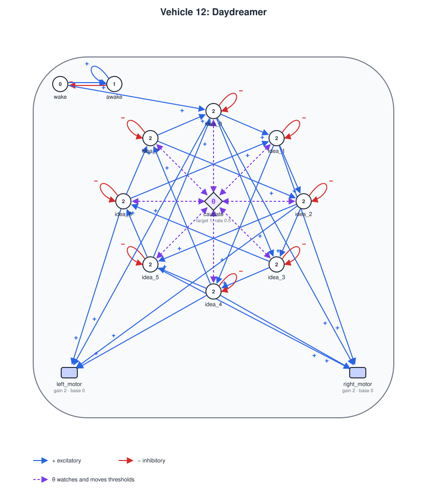
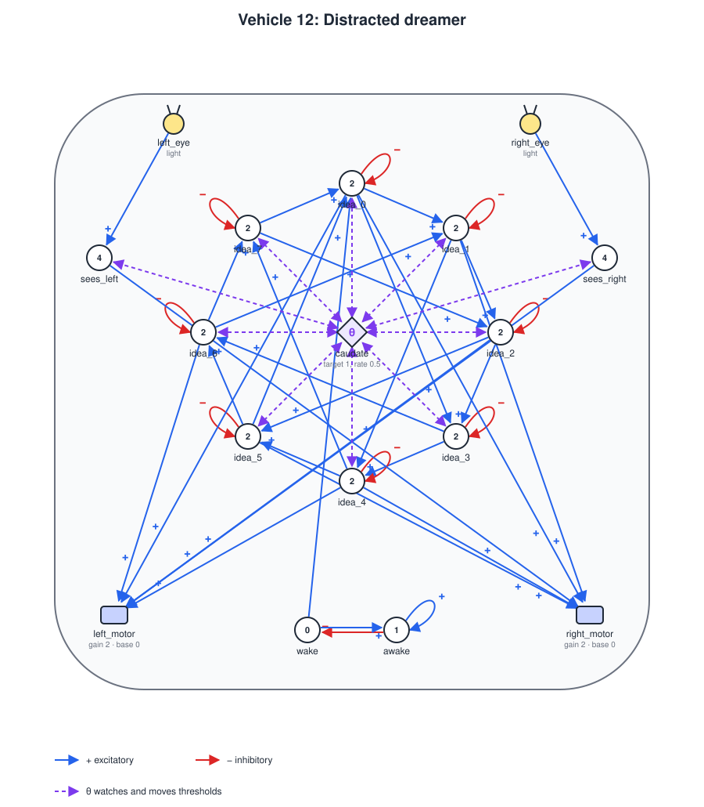
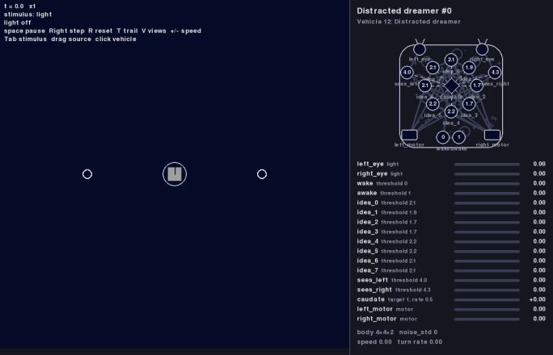

# Vehicle 12 — Trains of Thought: threshold control

**Status:** implemented: variable thresholds, the threshold control unit and a first example, the daydreamer, whose ideas are wired by hand (values checked on seeds 0 to 4, see *Acceptance criteria*). Its trains of thought settle into loops (see *Whether its thoughts vary*). A second example, the distracted dreamer (see *Second example: the distracted dreamer*), is implemented too. A version that learns its ideas, and the learning rule it needs (see *Open questions*), are still to be specified.



## Summary

Braitenberg's chapter on Vehicle 12 ("Trains of Thought") starts from a danger in the vehicles with learned associations. Units that excite each other can set off a chain reaction: if each active unit activates more than one other, activity explodes until the whole brain is on; if it activates fewer than one, activity dies out. His answer is a **threshold control**: a device that watches how many elements are active and raises everyone's threshold when there are too many, and lowers it when there are too few. Activity then neither explodes nor dies. It wanders through the network along its associations, even when the sensors are silent. That wandering is the train of thought.

This spec adds two things to the vehicle definition ([vehicle-definition.md](vehicle-definition.md)):

- **Variable thresholds:** a unit's threshold can move away from the value in its definition.
- **The threshold control unit**, a new unit type, `threshold_control`, which moves the thresholds of the units it controls according to how active the units it watches are.

### Why not inhibitory wires

An inhibitory wire from a threshold unit lowers a sum by 1 or not at all, because unit outputs are 0 or 1. A threshold control has to move in small steps, and it has to go in both directions: it must also make units easier to fire than their definition says, or a silent brain stays silent.

### Biological basis

In the book's biological notes, Braitenberg admits that the evidence in animal brains is only indirect, but finds it hard to see how they could work otherwise, with so many cortical neurons reciprocally connected by positive feedback. A cell assembly may be spread over wide regions of the cortex, so the mechanism that detects its ignition has to receive input from the entire cortex. He suggests the striatum-caudate complex, which accompanies the cortex throughout its extent and receives an orderly projection from all of it, acting back on the cortex probably through the paleostriatum-thalamus loop. He also suggests that the dynamics of threshold control may be chaotic, which he offers as a possible, and debatable, account of the freedom of thought.

So the example below names its control unit `caudate`, its `inputs` are the projection from the cortex, and its `delay` is the time around the loop.

## Variable thresholds

Every unit keeps its `threshold`, now called its **base threshold**, and has an **offset**, which starts at 0:

```
effective threshold = threshold + jitter + offset
```

- A threshold unit outputs 1 when the sum of its active inputs reaches its **effective threshold**, instead of its base threshold. Everything else about it stays as in [vehicle-definition.md](vehicle-definition.md), *Units*.
- The rule that a unit whose threshold is `0` or less fires on its own applies to the effective threshold.
- A unit that no threshold control controls has jitter 0 and offset 0, so it behaves exactly as before.
- A unit has at most one threshold control.

## The threshold control unit

```yaml
- unit:
    name: caudate
    type: threshold_control
    inputs:
      - input:
          from: idea[:]        # what it watches: the whole 'cortex'
    controls: [idea]           # whose thresholds it moves
    target: 5                  # how much activity it wants
    rate: 0.5                  # offset per second, per unit of activity above or below target
    delay: 0.05                # seconds around the loop
    jitter: 0.3                # largest fixed difference from the base threshold
```

| Key | Required | Meaning |
|---|---|---|
| `name` | yes | Unique name. |
| `type` | yes | `threshold_control`. |
| `inputs` | yes | The signals it adds up, in the same form as a threshold unit's inputs (*Inputs*), with their signs. See *The rule* for what it reads from them. |
| `controls` | yes | A non-empty list of names of threshold units or arrays, whose thresholds it moves. |
| `target` | yes | The activity it wants. Not negative. |
| `rate` | yes | How fast it corrects. Positive. |
| `delay` | no | Seconds between computing an offset and the units using it. Default `0.05`. Must be positive. |
| `jitter` | no | The largest fixed difference between a controlled unit's threshold and its base threshold, in either direction. Not negative. Default `0`. |
| `position` | no | As for a threshold unit. |

### The rule

Each step, the control unit adds up its active inputs; that sum is its **activity**. From a unit, it reads the unit's **activation**, just computed this step, not its output, which only appears `delay` seconds later. From a sensor, it reads the sensor's output. There is no simultaneity window: it reads this step's values only.

It reads activations because it must catch an ignition as it starts, as Braitenberg asks. Reading outputs, it would learn of an ignition one unit delay late, and in that time the ignition spreads. With the daydreamer's one-second ideas, a control that read outputs never settled: activity went from nothing to all eight ideas and back, over and over.

Then:

```
offset += rate * (activity - target) * dt
```

The offset has no limits and starts at 0. There is one offset per control unit, shared by all the units it controls.

The correction **accumulates**. A control that set the offset directly from the activity would hold a fixed offset whenever activity is 0, and if that offset is not low enough to fire anything, the brain stays silent forever. An accumulating control keeps lowering the thresholds until something fires. It needs no limits because it limits itself: once offsets are low enough, units fire on their own and activity pushes the offset back up. Likewise, once they are high enough, nothing fires and activity pushes it back down, provided the control watches units it controls.

### Jitter

Unit outputs are 0 or 1, so in a large network many units have exactly the same sum. As a falling threshold reaches that sum, they would all fire on the same step, which is the explosion the control exists to prevent. So when the vehicle is built, each controlled unit gets a fixed difference, drawn uniformly from `[-jitter, jitter]`. The values come from the scenario's seed (with the vehicle's place in the scenario, so that two vehicles get different values) and do not change during the run, so the units fire in a fixed order of precedence, and no noise is added to the dynamics. Each element of an array gets its own value. With `jitter` 0, nothing is drawn.

### Signal flow

Control units update in step 2 of the signal flow ([vehicle-definition.md](vehicle-definition.md), *Signal flow*), with the units:

- **Outputs.** Each control unit's visible offset becomes the one it computed `delay` seconds ago, rounded to whole steps, at least one. Before that it is 0.
- **Activations.** Threshold units compare their sums with their effective thresholds, using the visible offset. Then control units compute their activity from those activations and this step's sensor outputs, and their new offset, which enters their delay line.
- **Learning** is as before, and uses base thresholds (see below).

### Learning uses the base threshold

The learning rules of Mnemotrix ([vehicle-07.md](vehicle-07.md)) and Ergotrix ([vehicle-11.md](vehicle-11.md)) keep comparing sums with `threshold`, the base threshold, and ignore jitter and offset. What a vehicle learns should depend on the events it meets, not on the momentary state of its control. An Ergotrix wire also needs this: with an effective threshold at 0 or below, its destination would count as driven all the time, and the wire would never see it turn on.

### Limits

For now, a control unit's only output is its offset:

- No threshold unit, motor or other control unit can take a control unit as an input.
- A control unit cannot be an array.

## Loading and validation

In addition to the checks in [vehicle-definition.md](vehicle-definition.md), *Loading and validation*, it is an error, naming the file and the key, if:

- `controls` is missing or empty, or names something that does not exist, a sensor or a control unit.
- A unit is controlled by more than one control unit.
- An input of a threshold unit, actuator or control unit comes from a control unit.
- `target` or `jitter` is negative, `rate` or `delay` is not positive, or a control unit has `threshold` or `array`.

## Display

- **Simulator panel:** each controlled unit shows its current effective threshold, with one decimal; an array shows its base threshold plus the offset, since jitter differs from element to element. The control unit is a diamond, lit by the activity it sees (half lit at its target), and its readout shows its visible offset, with its sign.
- **SVG diagram** ([vehicle-diagram.md](vehicle-diagram.md)): a controlled unit shows its base threshold, because the diagram describes the definition, not a moment of the run. The control unit has its own shape. Its inputs are drawn like any others, and its `controls` as dashed arrows, one per array. When it both watches and controls a part, the wire it watches by and its arrow are drawn as one dashed line, with an arrowhead at each end.
- **Analysis:** a vehicle exposes each control's visible offset (its output) and the activity it saw at the last step, for a script to record and plot with `matplotlib`. No plotting tool is part of this spec.

## Example: the daydreamer

The daydreamer sits in an empty, dark arena. It has nothing to sense, yet it keeps moving: its movements come from a train of ideas inside it, one leading to the next.

### Ideas

The vehicle has no sensors. Its 'cortex' is 8 threshold units, `idea_0` to `idea_7`, with `delay` 1, so that each idea stays on for about a second: long enough to see its gesture. Each idea excites two others, the next one and the one three places on, around a ring:

```
idea_k → idea_(k+1 mod 8) and idea_(k+3 mod 8)
```

The ideas are written one by one, not as an array ([vehicle-08.md](vehicle-08.md)), so that the diagram can place them on a circle and show the ring and its wires; an array would be drawn as a strip, with all its wires folded into one loop. In the diagram, the next-idea wires go around the circle and the three-on wires make a star inside it.

Since each idea fires two, the network is explosive on purpose.

Each idea also **inhibits itself**. A unit's input counts for its whole simultaneity window ([vehicle-definition.md](vehicle-definition.md), *Units*), which for a one-second delay is one second long. Without the self-inhibition, an idea would stay on one window longer than the idea that fired it, and each idea in a train would last a second longer than the one before. With it, an idea goes off as soon as its own output appears, so each idea lasts one delay, however long the one before lasted.

The first idea, which also takes the start pulse:

```yaml
- unit:
    name: idea_0
    type: threshold
    position: [0.0, 0.7]       # on a circle, clockwise from the top
    threshold: 2
    delay: 1
    inputs:
      - input:
          from: idea_7         # the previous idea
      - input:
          from: idea_5         # and the one three places back
      - input:
          from: wake           # the start pulse
      - input:
          from: idea_0         # itself, inhibitory: an idea fires once, for one delay
          type: inhibitory
```

The others are alike, without `wake`.

### Gestures

Each idea moves the motors its own way. Motors do not run backwards, so the gestures are those of two forward motors:

| Ideas | Gesture | Left motor | Right motor |
|---|---|---|---|
| `idea_0`, `idea_4` | forward | on | on |
| `idea_1`, `idea_5` | turn left | off | on |
| `idea_2`, `idea_6` | turn right | on | off |
| `idea_3`, `idea_7` | stop | off | off |

So the left motor takes `idea_0`, `idea_2`, `idea_4` and `idea_6`, and the right motor `idea_0`, `idea_1`, `idea_4` and `idea_5`. A train of thought is a sequence of gestures, and it can be read in the vehicle's track.

### Waking up

All units start off, so something has to start the first idea. A pair of units makes a single pulse at the start of the run, with existing parts only:

| Unit | Threshold | Inputs | Does |
|---|---|---|---|
| `wake` | 0 | `awake`, inhibitory | fires on its own from the start, until `awake` stops it |
| `awake` | 1 | `wake` and itself | turns on after `wake` and stays on |

`wake` sends one pulse to `idea_0` and is then held off by `awake` for the rest of the run. Neither is controlled.

### Three variants

The demonstration is the same network in three variants:

| Variant | File | Base threshold | Control | Expected |
|---|---|---|---|---|
| Flooded | `vehicles/vehicle12-daydreamer-flooded.yaml` | 1 | none | The pulse fires `idea_0`, which fires two, and soon all 8 ideas are on, each kept on by its two predecessors against its own inhibition. Both motors get the same input, so the vehicle drives straight ahead forever: one fixed behavior, no sequence. |
| Silent | `vehicles/vehicle12-daydreamer-silent.yaml` | 2 | none | One active idea cannot reach a threshold of 2, and the pulse alone cannot either. Nothing ever fires and the vehicle never moves. |
| Daydreamer | `vehicles/vehicle12-daydreamer.yaml` | 2 | `caudate` | Activity stays at a few ideas and passes from one to the next: a sequence of gestures, with no stimulus at all. |

The daydreamer is the silent variant plus the control unit:

```yaml
- unit:
    name: caudate
    type: threshold_control
    position: [0, 0.2]         # in the middle of the ring
    inputs:
      - input:
          from: idea_0
      # ... and so on, one input per idea, to idea_7
    controls: [idea_0, idea_1, idea_2, idea_3, idea_4, idea_5, idea_6, idea_7]
    target: 1
    rate: 0.5
    delay: 0.05                # one step: much shorter than an idea, to catch an ignition early
    jitter: 0.3
```

With no activity at first, the control lowers the thresholds until an idea fires. The pulse has passed by then, so an idea fires on its own: the daydreamer wakes up by itself, after about 3 seconds. When two ideas ignite together, the control raises the thresholds within a step or two until the one with the higher threshold goes off, so at a branch the idea with the lower threshold wins. Faster controls (larger `rate`) cut ideas short and make them flicker; slower ones let more ideas on at once. The values were chosen on seeds 0 to 4.

The scenario `scenarios/vehicle12-daydreamer.yaml` places the daydreamer in `worlds/open-field.yaml`, and `scenarios/vehicle12-daydreamer-flooded.yaml` and `scenarios/vehicle12-daydreamer-silent.yaml` place the other two variants the same way.

### Whether its thoughts vary

Mostly, they do not. Jitter is fixed, and once a train runs smoothly, with one idea on at a time, the offset holds still, so at each branch the same idea wins every time. After a few seconds, the daydreamer settles into a loop of 4 to 6 ideas and repeats it for the rest of the run: a fixed sequence of gestures, which traces a fixed figure in the field. Which loop depends on the seed, which sets the jitter.

The exception is a seed whose jitter leaves two ideas almost tied (seed 1). There the control cannot settle: two ideas flicker on and off together, the offset keeps moving, and the train never repeats. That is the varied thought Braitenberg describes, but here it comes with ideas cut short, about 0.4 s instead of 1 s.

So with one unit per idea and a fixed jitter, this circuit gives either a smooth train that loops or a varied train that stutters. Braitenberg's suggestion that threshold control may be chaotic is not shown here.

### Not the wanderer

From outside, the daydreamer could be mistaken for a vehicle with the `wander` module, which moves at random. It is different inside: there is no noise, the same seed gives the same run, and each idea turns on because an idea wired to it was on, or, when the thresholds are low enough, on its own.

## Second example: the distracted dreamer

The daydreamer thinks in the dark. The distracted dreamer is the daydreamer with eyes, in a field with two lamps that take turns: a dim one and a bright one. Its thoughts and what it sees compete for the same activity, because the caudate watches and controls both.

- **A dim lamp** does not reach the eyes' threshold, and the daydreamer goes on with its gestures, absorbed.
- **A bright lamp** fires what it sees. Now the caudate sees two things on, a thought and the lamp, more than its target, and it raises every threshold until one goes off. The lamp, read by a sensor whose reading keeps rising as the vehicle turns to it, outlasts the thought: the train of thought stops, and the vehicle heads for the lamp. Something has caught its attention.
- **When the bright lamp goes off,** nothing is on, and the thresholds fall until an idea fires on its own: it goes back to its thoughts. This takes a while, because the brighter the lamp it was looking at, the higher the thresholds had to go to keep only one thing on, and the longer they take to come down.

What the caudate does here is not to raise thresholds while it thinks: while it thinks, thresholds are lower than the base values, since the ideas need it. What it does is share one budget of activity, about one thing on at a time, between thinking and seeing.

### Eyes and attention



The vehicle has the daydreamer's ring of ideas, its caudate and its `wake` pulse, plus:

| Part | Kind | Inputs | Does |
|---|---|---|---|
| `left_eye`, `right_eye` | light sensors at `[∓0.6, 0.9]`, seeing all around, linear response | | read the light |
| `sees_left`, `sees_right` | threshold units, `threshold` 4, `delay` 0.2 | `left_eye`, `right_eye` | fire when a lamp is bright enough at that side |
| `left_motor`, `right_motor` | the daydreamer's motors | also `sees_right`, `sees_left`, crossed | turn toward the lamp, as Vehicle 2b does |

The caudate also watches `sees_left` and `sees_right`, and controls them: its `inputs` and its `controls` list both, besides the eight ideas. With its target of 1, the ideas and the eyes share one unit of activity.

While it thinks, the offset is about -1, so the eyes fire from a reading of about 3; their jitter moves this by up to 0.3. When a lamp holds one of them on, the offset rises above 0, so the ideas, whose effective threshold is then well above 1, cannot fire, since an idea gets at most 1 from the idea before it. When both eyes see the lamp, the caudate raises the thresholds until one goes off, and the one with the lower threshold keeps steering.

### The world

`worlds/two-lamps.yaml`: an arena 100 by 100 with wrapping edges and one stimulus, `light`, with two lamps that take turns, each with `falloff` 15:

| Lamp | Position | Intensity | On, in every 100 s |
|---|---|---|---|
| Dim | `[25, 50]` | 4 | from 10 to 30 s |
| Bright | `[75, 50]` | 20 | from 50 to 70 s |

The vehicle starts at `[50, 50]`, 25 units from each. There the dim lamp reads about 1.1 at each eye and the bright one about 5.5.

### Two variants

| Variant | Files | Caudate | Expected |
|---|---|---|---|
| Distracted | `vehicles/vehicle12-distracted.yaml`, `scenarios/vehicle12-distracted.yaml` | watches and controls the eyes and the ideas | Ignores the dim lamp; the bright lamp stops its thoughts and draws it in; its thoughts come back about 20 s after the lamp goes off. |
| Absorbed | `vehicles/vehicle12-distracted-absorbed.yaml`, `scenarios/vehicle12-distracted-absorbed.yaml` | watches and controls the ideas only | Its eyes fire at their base threshold of 4, but they do not count in the caudate's budget, so it keeps thinking while it sees the bright lamp: its gestures and its steering mix, and it does not always reach the lamp. |

### What it shows



*The default scenario, first 100 s, at five times the speed: the dim lamp at the left, the bright one at the right.*

On seeds 0 to 4, over three 100-s cycles each:

- The dim lamp was ignored in every cycle except when the vehicle had wandered within a few units of it, where it reads as strongly as the bright lamp from afar; then it caught the vehicle's attention too.
- When the bright lamp came on within about 40 units, an eye fired within 0.3 s and the train of thought stopped, after up to 3 s in which ideas and eyes flickered while the caudate settled. From within 30 units, the vehicle came within about 12 units of the lamp; from farther, it sometimes circled without reaching it. Farther than about 50 units, the lamp was too faint to notice.
- After the bright lamp went off, the first idea fired again after 15 to 21 s, once after 5 s.
- The absorbed variant went on firing ideas, about 20 in each bright phase, while it saw the lamp.

## Acceptance criteria

Criteria 7 and 8 use the daydreamer's network.

1. **Unchanged without control:** a vehicle with no control unit produces exactly the same trajectory, for the same seed, as before this spec.
2. **Effective threshold:** with jitter 0, a unit with `threshold` 1 and a sum of 1 fires with offset 0 and does not fire with offset +0.05. A unit with `threshold` 2 and a sum of 1 fires with offset -1.
3. **Firing on its own:** with jitter 0, a controlled unit with `threshold` 1 and no active input fires once the offset reaches -1.
4. **The rule:** with `rate` 0.5, `target` 2 and `dt` 0.05, the offset rises by 0.05 per step at activity 4 and falls by 0.05 per step at activity 0, without limits.
5. **Delay:** with `delay` 0.1 and `dt` 0.05, a new offset reaches the controlled units 2 steps after it is computed.
6. **Learning:** a Mnemotrix or Ergotrix connection into a controlled unit changes its strength step by step exactly as it does with offset 0 and jitter 0, whatever the actual offset and jitter.
7. **No explosion:** the daydreamer's ideas with base threshold 1 reach full activity without a control unit (the flooded variant). With the daydreamer's control and the same base threshold 1, after the first 10 s they never have more than 3 ideas on at once, and their mean activity is between 0.5 and 1.5, for seeds 0 to 4.
8. **No extinction:** in the daydreamer, when every unit's activity and the offset are reset to 0 at 60 s, an idea fires again within 5 s, because the offset falls until something fires.
9. **Jitter:** each difference lies within `[-jitter, jitter]`, the same seed gives the same differences and the same run, and they do not change during the run. With `jitter` 0, every difference is 0.
10. **Validation:** each failure case under *Loading and validation* raises an error naming the file and the key.
11. **Display:** the diagram shows the control unit, its inputs and its dashed `controls` arrows, without importing pygame, and the renderer draws its window without errors.
12. **Headless:** loading and running a vehicle with a control unit never imports pygame.

The daydreamer, with `noise_std` 0, for seeds 0 to 4, 120 s each:

13. **Waking up:** in all three variants, `wake` fires for one pulse at the start and never again.
14. **Flooded:** within 10 s, all 8 ideas are on, and they stay on to the end. From then on, both motors run at the same speed, and the heading does not change.
15. **Silent:** no idea ever fires, and the vehicle does not move.
16. **Daydreamer:** an idea turns on in the last 5 s of the run, at least 4 different ideas fire, and after the first 10 s never more than 3 are on at once. The vehicle travels more than 80 units, and after the first 10 s its heading takes more than 20 values (in steps of 10°).
17. **Trains:** at least 70% of idea onsets are along a wire: the idea turns on while an idea wired to it was on in the second before.
18. **Deterministic:** the same seed gives the same sequence of ideas. Different seeds, which give different jitter, are not required to give different sequences (see *Whether its thoughts vary*).

The distracted dreamer, for seeds 0 to 4, 300 s each (three cycles of the lamps):

19. **Ignores a dim lamp:** while each eye reads less than 2.5 from the dim lamp, neither `sees_left` nor `sees_right` fires. In a dim phase where that holds throughout, at least 5 ideas turn on.
20. **Caught by a bright lamp:** in each cycle in which the vehicle is within 40 units of the bright lamp when it comes on, an eye fires within 1 s, and no idea turns on from 5 s after it comes on until it goes off. In the first seconds, ideas and eyes may flicker while the caudate settles. When the vehicle starts within 30 units, it comes within 15 units of the lamp; from farther, it may see the lamp yet circle without reaching it. At least two cycles of each run qualify.
21. **Back to its thoughts:** after the bright lamp goes off, an idea turns on within 25 s (checked in the first two cycles; the third ends with the run).
22. **Absorbed:** in the absorbed variant, in each cycle in which an eye fires while the bright lamp is on, at least 10 ideas turn on during that phase.
23. **Display and headless:** the diagram of the distracted dreamer shows its eyes and the caudate's lines to them, and running it never imports pygame.

## Open questions

These belong to the version of the daydreamer that learns its ideas, and have to be settled before it is specified:

- **A daydreamer that learns.** Instead of wired by hand, its ideas would be learned with Ergotrix wires: by day it sees colored lights in fixed sequences, and at night it rehearses them.
- **Thinking would erase memory.** A train of thought needs Ergotrix wires between internal units. In the dark, such a wire's source fires, the real event never comes, and the wire loses `forget` ([vehicle-11.md](vehicle-11.md), *The rule*). With the Vehicle 11 values (`forget` 0.1), a wire at strength 1 goes inactive after three rehearsals. It probably needs a rule such as: only a source driven by its fixed inputs starts a wait.
- **Varied trains.** The daydreamer's smooth trains loop (see *Whether its thoughts vary*). Ideas made of several units each (cell assemblies), where an idea can be partly on, might give the control a finer hold and let the same idea lead to different successors. That is untried.
- **The sequence module.** The Ergotrix circuit of Vehicle 11 is due to become a module in `modules/` once Vehicle 12 is its second user ([modules.md](modules.md)).

## Out of scope

- Ideas made of several units each (cell assemblies), instead of one unit per idea.
- Several control units for one unit, regional controls beyond listing the units in `controls`, and control units that watch or control each other.
- Reading a control unit's offset from other parts, such as a motor that slows down when thresholds are high.
- Limits on the offset, and control rules other than the accumulating one.
- Random noise in thresholds during a run.
